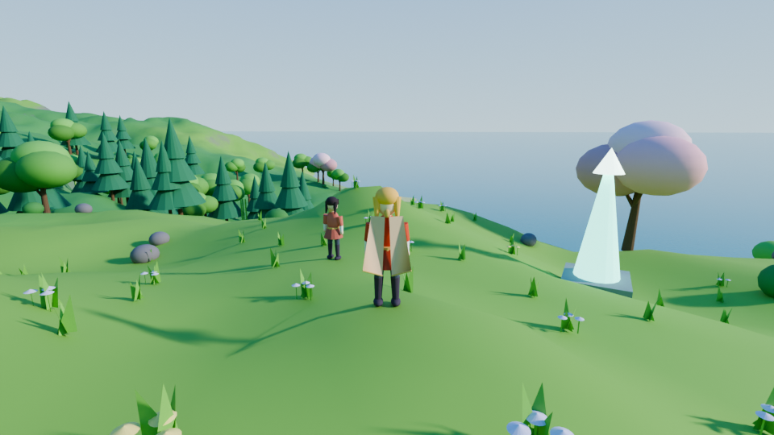
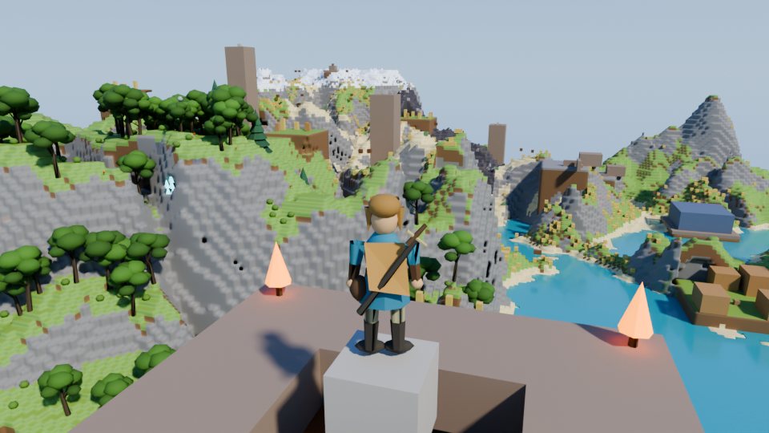
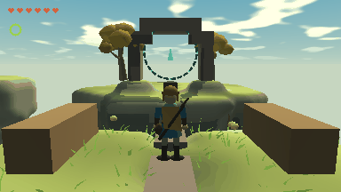

# Open-World Bench

**A benchmark for the memory of long-horizon embodied agents.**

Open-World Bench (OWB) evaluates whether an embodied agent can *remember* — across
hours of interaction, across sessions, and across changes to the world — the things it
has seen, learned, and been told. Most embodied benchmarks fit inside a single episode
and a single context window. OWB deliberately does not: tasks are designed so that the
information needed to act correctly was acquired long before it is needed, and must be
recalled, re-grounded, and acted upon.

## Environments

OWB bundles several open-world environments that span voxel crafting, large-scale
anime-styled 3D exploration, physics-driven puzzle traversal, and real-world robot
navigation. Each is a clean-room research environment inspired by the games below; no
game assets or code are redistributed.

| Environment | Inspired by | What it stresses |
| --- | --- | --- |
| `minecraft` | Minecraft | Open-ended crafting and building: deep tech trees, resource bookkeeping, base/landmark recall over very long horizons. |
| `teyvat` | Genshin Impact | Large anime-styled 3D island world: multi-stage quests, NPC dialogue, elemental interactions, long-range navigation and landmark memory. |
| `wildlands` | The Legend of Zelda: Breath of the Wild | Emergent physics and survival: shrine-style puzzles, weather and temperature, durable-vs-consumable resource tracking, exploration under partial maps. |
| `skylands` | The Legend of Zelda: Tears of the Kingdom | Vertical, three-layer worlds plus construction: combining parts into contraptions, reusing recipes discovered much earlier, sky/surface/depths cross-referencing. |
| `mobile_robot` | Real indoor/outdoor mobile robots | Grounded embodied navigation: continuous control, noisy sensing, semantic mapping, revisiting places and objects after long delays. |

## Latest demos

### Teyvat and Wildlands — Blender renders

The latest Teyvat and Wildlands showcase renders use seed 7 and Blender Cycles
for offline rendering, with indirect lighting, cast shadows, reflective water,
and smoother geometry. Agent observations and gameplay recordings use the CPU
renderers.

| Teyvat — Blender Cycles | Wildlands — Blender Cycles |
| --- | --- |
|  |  |

```bash
python -B -m owb.scripts.render_blender \
  --env teyvat wildlands --seed 7 --view showcase \
  --size 960 540 --samples 48 --blender /path/to/blender \
  --output /tmp/owb-blender-demo
```

Each export produces a PNG, an editable `.blend`, and a `.glb` for importing into
Godot. A live Godot backend and detailed authored character assets are future
work. See the [rendering guide](docs/rendering.md) for setup, state capture,
and current limits.

### Skylands — construction demo

The agent grabs two beams, places them across the gap, walks over the completed
bridge, and activates the beacon. This seed-7 run uses the shared agent interface
and recorder: 30 decisions at 0.2 simulated seconds each, shown in a third-person
384 × 216 view. The policy is a scripted showcase of the introductory course.



[Open the Skylands recording](assets/demos/skylands.gif) ·
[Static preview](assets/demos/skylands-preview.png) ·
[Controls and environment guide](docs/skylands.md)

<details>
<summary>Reproduce the Skylands recording</summary>

After installing the `video` extra, run this from the repository root. Choose a
new output directory for each recording.

```python
from owb import make_env
from owb.bench import DemoPolicy, run_episode
from owb.env.skylands import default_config

cfg = default_config(small=True)
cfg.render_cfg.third_person = True
cfg.render_cfg.cam_distance = 5
cfg.render_cfg.cam_pitch_offset = -0.14
cfg.render_cfg.hud = True
cfg.sim_cfg.start_time = 0.38
with make_env("skylands", native_config=cfg, image_size=(384, 216), max_steps=45) as env:
    run_episode(env, DemoPolicy(), seed=7,
                output_dir="/tmp/owb-skylands-readme-demo", video="gif")
```

</details>

## Why memory

Each environment contributes tasks along the same axes, so results are comparable
across them:

- **Spatial memory** — recall where a place, resource, or object was, and get back to it.
- **Episodic memory** — recall *what happened*: who said what, which door was opened,
  what a trial-and-error attempt already ruled out.
- **Procedural memory** — reuse a recipe, build, or route discovered many steps earlier.
- **Interference and staleness** — the world changes; the agent must notice that what it
  remembers is no longer true.
- **Cross-session persistence** — an episode is paused and resumed, or a task spans
  several episodes in the same world seed.

Tasks are evaluated on task success and on memory-specific probes (targeted queries
and detours that are only solvable with the right recollection), not on reward alone.

## Status

Early and under active construction. Wildlands (`owb/`) now connects voxel terrain,
rendering, traversal, weather, gathering, cooking, and survival in a runnable
Gymnasium environment. The anime-styled world lives in `open_world_bench/`.
Skylands adds a runnable layered construction course on the Wildlands simulator.
Task suites and baseline agents are still being filled in. APIs will change
without notice until a tagged release.

## Run the environments

Use `owb.make_env("teyvat")` or `owb.make_env("wildlands")` for a shared agent
interface, mixed-environment batching, and recording. See the
[shared framework guide](docs/framework.md). `owb.make_env("skylands")` runs the
new construction course through the same interface (now schema version 2).

```bash
python -B -m owb.scripts.benchmark --env skylands --seed 7 --steps 45 \
  --size 384 216 --policy demo --video gif --output /tmp/owb-skylands-demo
```

Record both with the same policy and recorder, using the presentation preset:

```bash
pip install -e ".[video]"
PYTHONDONTWRITEBYTECODE=1 python -m owb.scripts.benchmark \
  --env teyvat wildlands --seed 7 --steps 40 --size 384 216 \
  --policy demo --quality presentation --video gif \
  --output /tmp/owb-readme-demo
```

Each environment gets its own GIF, configuration, event log, and episode summary.
Choose a new output directory for another run; existing recordings are preserved.
Use `--quality fast` for lower-cost rendering.

The native Wildlands demo is also available:

```bash
python -m owb.scripts.wildlands --seed 7 --steps 100 --output /tmp/wildlands.ppm
python -m owb.scripts.wildlands --interactive --steps 3000
```

For agents, import `owb` and use `gymnasium.make("OpenWorldBench/Wildlands-Small-v0")`.
See [the Wildlands guide](docs/wildlands.md) for actions, observations, configuration,
terminal controls, and current limitations. Rendering runs on the CPU without a display.

## Installation

```bash
git clone <repo-url>
cd open-world-bench
pip install -e ".[gl,video,dev]"
```

Python 3.10+. Extras: `gl` (OpenGL rendering), `video` (episode recording),
`fast` (numba-accelerated world generation), `dev` (tests).

## Teyvat: party and elemental combat

The anime-styled environment runs headlessly with the NumPy renderer. Its default
party is Kestrel (ember), Maren (tide), and Wren (gale). Nym (frost), Vex (spark),
and Boro (stone) are also available; configure one to four slots with `PartyConfig`.
Each member keeps their own health, energy, skill cooldown, and burst cooldown when
swapped out. Basic attacks are physical; skills and bursts apply elements.

```python
import gymnasium as gym
import numpy as np
import open_world_bench  # registers the Gymnasium environments
from open_world_bench import PartyConfig

env = gym.make(
    "OpenWorldBench/Genshin-Small-v0",
    backend="soft",
    text_obs=True,
    party=PartyConfig(members=("maren", "kestrel", "wren")),
)
obs, info = env.reset(seed=7)

# Cast Maren's tide skill. Enemies within 6.5 m acquire a decaying tide aura.
action = {
    "move": np.zeros(2, dtype=np.float32),
    "look": np.zeros(2, dtype=np.float32),
    "buttons": np.array([0, 0, 0, 0, 0, 1, 0], dtype=np.int8),
    "swap": 0,
}
obs, reward, terminated, truncated, info = env.step(action)

# Switch to Kestrel and cast ember in the same step. A nearby soaked enemy
# in the forward attack cone triggers Steamburst.
action["swap"] = 2
obs, reward, terminated, truncated, info = env.step(action)
print(info["active_character"], info["event_details"])
env.close()
```

| Control | Meaning |
| --- | --- |
| `move`, `look` | Two floats each in `[-1, 1]`; camera-relative motion and camera rotation. |
| `buttons` | Seven bits: jump, sprint, interact, physical attack, climb, skill, burst. |
| `swap` | `0` keeps the active character; `1..N` selects a party slot. Swaps have a one-second cooldown. |
| `flat_actions=True` | Fifteen floats: move (2), look (2), buttons (7), swap requests (4). Buttons fire above zero; the largest positive valid-slot request wins. |

Controls execute in the order swap, movement/world update, interact, attack, skill,
burst. Attacks and abilities fire once per agent step, regardless of `action_repeat`.
Unavailable skills, bursts, or swaps do nothing. Bursts require 60 energy, earned
passively, on hits, and through reactions. Legacy five-button and nine-float inputs
remain accepted; `party=None` restores the original action and observation spaces.

Observations include `rgb`, `proprio`, `task`, and a 30-float `party` vector. The first
28 values contain four padded slots of seven values: active, health fraction,
energy fraction, skill cooldown readiness, burst cooldown readiness, element ID / 6,
and alive. The last two are shield strength / 100 and swap cooldown readiness.
Burst cooldown readiness alone does not imply sufficient energy. With
`text_obs=True`, `instruction` adds the current quest text. `info["party"]` reports
member summaries; `info["event_details"]` includes reaction names, damage, shield
breaks, swaps, and defeats. Event slot indices are zero-based.

All eight reactions are connected: Steamburst, Thaw, Glaciate, Conduit,
Shattercharge, Overpressure, Squall, and Encase. Reactions can splash damage,
freeze or stun enemies, spread auras, knock enemies back, or grant shields.
Beacon guards carry elemental shields. Downed characters automatically yield to
an alive party member; a party wipe revives the team at a waypoint by default.
With `WorldConfig(respawn_on_death=False)`, a wipe terminates the episode.

Character colors, floating enemy aura markers, shield rings, and short skill
effects appear in RGB observations. `env.unwrapped.render_hd()` also overlays party
health, energy, and skill readiness. Skills currently apply immediately; persistent
fields, travelling projectiles, and combat line-of-sight checks remain future work.

Run the combat and environment contract checks with:

```bash
PYTHONDONTWRITEBYTECODE=1 python -m pytest -q -p no:cacheprovider tests/test_combat.py
```

## License

MIT — see [LICENSE](LICENSE). Environments are original implementations; the games
listed above are referenced only to describe the setting each environment evokes, and
are trademarks of their respective owners.

## Citation

If you use Open-World Bench in your research, please cite:

```bibtex
@misc{openworldbench2026,
  title        = {Open-World Bench: Benchmarking Memory in Long-Horizon Embodied Agents},
  author       = {Su, Chloe},
  year         = {2026},
  howpublished = {\url{https://github.com/Hither1/open-world-bench}}
}
```
