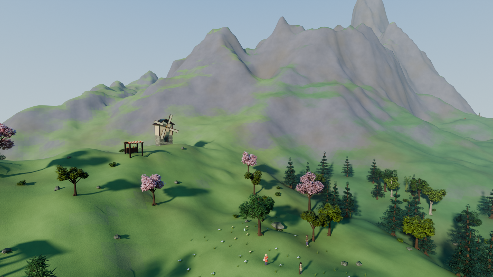
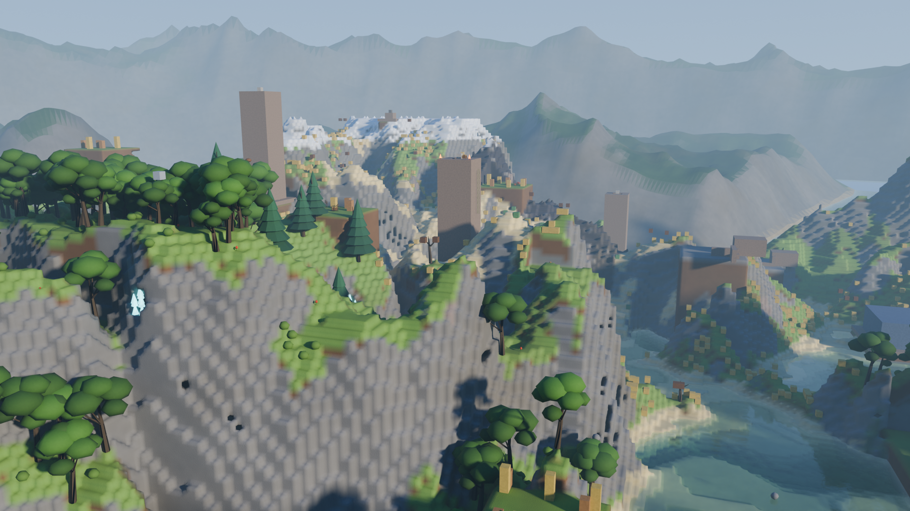
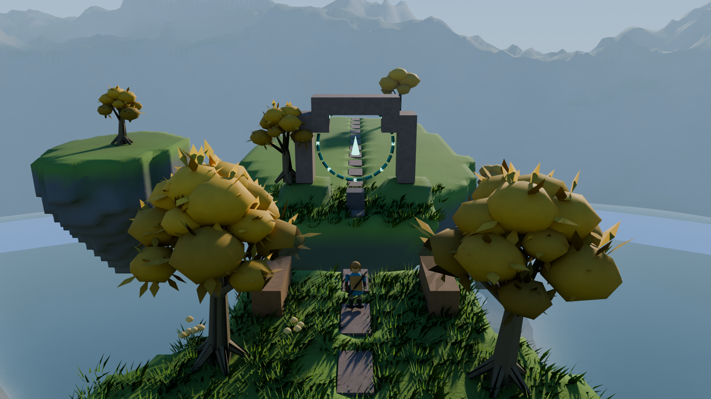
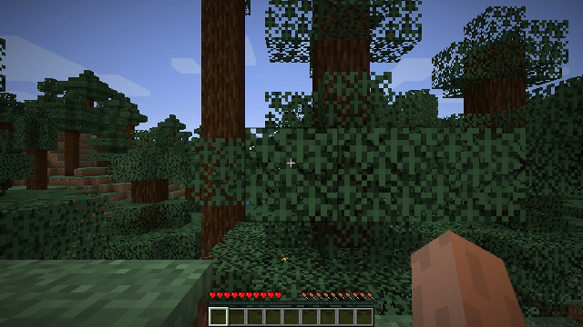
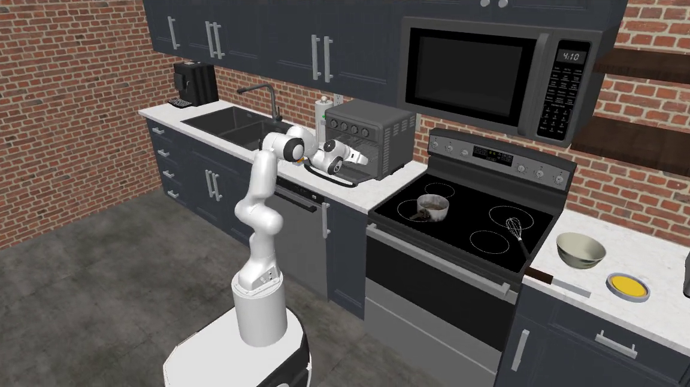

# Environment covers

Matching 16:9 covers for all five environments on the project website and GitHub
README. Each image comes from the actual environment. PNG originals and WebP
delivery copies retain their native pixel dimensions; none is upscaled.

| Environment | Cover | Tagline |
| --- | --- | --- |
| Teyvat |  | **Explore. Solve. Remember.** |
| Wildlands |  | **Explore. Survive. Remember.** |
| Skylands |  | **Build. Traverse. Remember.** |
| Minecraft |  | **Gather. Craft. Remember.** |
| Mobile manipulation |  | **Navigate. Manipulate. Remember.** |

## Short descriptions

**Teyvat.** Explore an island world of quests, elemental puzzles, and combat. Remember clues, landmarks, and earlier discoveries to unlock new paths and complete distant objectives.

**Minecraft.** Gather resources, craft tools, and progress from basic survival to deep mining and exploration. Remember recipes, routes, and useful procedures across long journeys.

**Mobile manipulation.** Navigate a kitchen, handle ingredients and tools, and carry out cooking tasks. Remember object locations, recipe instructions, and appliance controls through cleanup.

**Wildlands.** Explore a changing wilderness, manage supplies, and overcome environmental challenges. Remember landmarks, resources, and past discoveries to plan your next move.

**Skylands.** Traverse floating islands, surface landscapes, and underground depths. Build crossings, transport cargo, and reuse earlier discoveries to complete journeys across all three layers.

## Source and scope

| Cover | Actual scene | Renderer and output |
| --- | --- | --- |
| Teyvat | Seed-7 reset of the full 1,024 m procedural island; independent presentation camera. | Blender Cycles / OptiX, 1920 × 1080, 128 samples. |
| Wildlands | Seed-7 reset of the full-size procedural sandbox. | Blender Cycles / OptiX, 1920 × 1080, 128 samples. |
| Skylands | Seed-7 reset of the introductory Aster Reach construction course, full-size variant. | Blender Cycles / OptiX, 1920 × 1080, 128 samples. |
| Minecraft | Step 1 of a Mine Diamond from Scratch run, in the Overworld. | Native Minecraft client via MineStudio/MCU, 640 × 360; HUD retained. |
| Mobile manipulation | PandaOmron lemon-tart run at video timestamp 05:20. | Native MuJoCo recording, 1152 × 648 pixel crop from 1280 × 720. |

The descriptions introduce the environments as a whole. The Skylands cover does
not depict its larger cargo/restoration campaigns, and the Teyvat cover does not
depict the separate 1,760 m Task B island. The robot recording reaches 20/21
milestones and does not complete the task. Covers do not claim task performance.

Minecraft and RoboCasa do not have a Cycles exporter in this repository. Their
covers are native captures, not Cycles renders. The Minecraft wire JPEG has its
red and blue channels reversed by the MCU encoder; extraction restores RGB order
using the same correction documented in the harness. No brightness adjustment or
retouching is applied. The kitchen crop is `(x=64, y=72, width=1152, height=648)`:
it removes the video caption and keeps a 16:9 scene without resampling.

## Files and use

- `*-cover.png`: full-size render/capture outputs. Keep the 16:9 aspect ratio.
- `*-cover.webp`: quality-92 website copies at the same dimensions.
- [copy.json](copy.json): names, descriptions, taglines, scope, and alt text.
- [manifest.json](manifest.json): renderer reports, cameras, extraction details,
  source/image hashes, and state-preservation checks.
- [covers.zip](covers.zip): all five covers in both formats, copy, and provenance.
- `sources/minecraft-step-0000001.jpg`: original MCU wire JPEG retained for
  reproducible decoding; use the decoded cover for display.

Keep names and descriptions in accessible HTML or Markdown beside the images.
The website uses them as video posters. Its separate cover and video captions
identify the different scenes. Minecraft is suitable for cards up to 640 pixels
wide; a larger native capture is needed for a full-width high-resolution hero.

## Cycles rendering and fidelity

Blender 4.5.4 LTS, Cycles / OptiX GPU, 128 samples, denoising enabled, 6 maximum
light bounces, AgX with Medium High Contrast, display exposure +0.65, opaque PNG.
The exposure is a display setting and does not change simulated lighting.

Camera-only exports verify that simulator state and RNG are unchanged. The
agent, terrain, collisions, clock, and weather are not moved or edited, and no
actions are executed. Existing presentation-only horizon ridges remain
decorative. Exporters retain their usual visibility/detail rules.

From the repository root, choose new output directories:

```bash
sbatch assets/covers/render_teyvat.slurm .cache/teyvat-cover-new
sbatch assets/covers/render.slurm .cache/wildlands-skylands-covers-new
python -B assets/covers/extract_native.py .cache/native-covers-new
```

The Slurm scripts each request one GPU for up to 30 minutes, preserve numeric
snapshots and editable `.blend` files, and refuse CPU fallback. Native extraction
uses FFmpeg and the original files already in the repository. Large Cycles scene
files stay in the local render cache. No simulator or observation code is changed.
