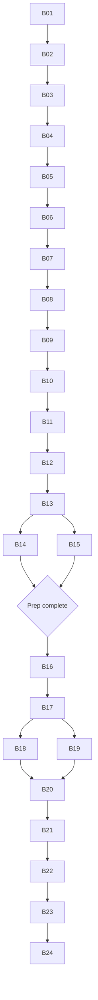

# Mobile robot: long-horizon memory tasks

Status: task designs, not runnable implementations. These two tasks retain
exactly **12** and **24** milestones, matching the
[Wildlands](wildlands-long-horizon-tasks.md) and
[Teyvat](teyvat-long-horizon-tasks.md) designs.

**Substrate.** These designs target a `mobile_robot` environment that reuses the
RoboCasa365 **simulator** — PandaOmron (a Franka arm on a holonomic base,
12-DOF), 60 kitchen layouts x 60 styles, 3,200+ object assets — and **none of
its 365 tasks**. `mobile_robot` is currently a README row with no
implementation, so the environment contract below is part of the design.

## Two questions

1. **Does memory help?** Can the agent act on information acquired long before
   it is needed, and does withholding that information measurably hurt?
2. **Does memory degrade as it accumulates?** As the store grows, do retrieval
   accuracy and learned-skill execution get *worse* — and if so, is that
   capacity, interference, retrieval failure, or crowding?

Question 2 is the harder one and it drives the structure below. A design that
answers only question 1 is the usual benchmark: show that a memoryless agent
fails and declare the memory tested. But an agent can pass question 1 at a small
store and still collapse at a realistic one, and that collapse is what matters
for an agent meant to run for days. These two tasks are built so that the same
probe battery runs at three different store sizes with delay held constant.

## Why RoboCasa365 tasks do not test memory

RoboCasa365's own tasks are short by construction, and the shortness is not only
about wall-clock horizon:

| Property | RoboCasa365 composite task | What a memory task needs |
| --- | --- | --- |
| Horizon | `horizon=1000` control steps at `control_freq=20`, i.e. ~50 simulated seconds. | Tens of thousands of steps, so the decisive exposure falls outside any plausible recent-context window. |
| Observability | Everything needed is visible, or becomes visible, within the one room the task occupies. | Information that was observable earlier and is not observable now. |
| Scope | One kitchen instance, one activity, 2–4 stages. | Several rooms or kitchen instances, with travel cost between them. |
| Success | A single instantaneous geometric predicate, e.g. `OU.check_obj_in_receptacle(self, "teacup", "saucer")`. | Latched milestones whose preconditions were established much earlier. |
| Information source | The evaluator places every object; the task states the goal. | Bindings the agent itself created, which no prior knowledge can supply. |
| Memory load | Nothing worth storing. | A store large enough that accumulation itself is a variable. |

A reactive policy with no memory at all is sufficient for any of the 301
composite tasks. That is the gap these two tasks target.

## What we reuse, and what we replace

RoboCasa365 separates cleanly into a simulator layer and a task layer, because
`Kitchen` is a concrete class, not an abstract one: `_get_obj_cfgs` returns `[]`,
`_setup_scene` is `pass`, and `_check_success` returns `False`. Instantiated
directly it is a fully furnished, randomized kitchen with the robot in it and no
task at all. That is exactly the substrate we want.

| Layer | Module | Use |
| --- | --- | --- |
| MuJoCo, controllers, PandaOmron | `robosuite` | Reuse as is. |
| Base environment: scene assembly, robot placement, cameras, object sampling | `robocasa.environments.kitchen.kitchen.Kitchen` | Subclass directly. |
| Fixtures: cabinets, drawers, fridge, microwave, oven, stove, sink, dishwasher, toaster oven, coffee machine, kettle, hood, counters, handles | `robocasa.models.fixtures` (24 modules) | Reuse. Supplies the articulated, openable, content-hiding fixtures the retrieval probe depends on. |
| Floorplans and visual styles | `robocasa.models.scenes` + `models/assets/scenes` (50 train + 10 test layouts, same for styles) | Reuse, and author additional layout YAML. |
| Object assets and registries | `robocasa.models.objects`, `lightwheel` / `objaverse` registries | Reuse. The asset count is what makes large distinct binding sets possible. |
| Placement sampling, object and camera utilities | `robocasa.utils.placement_samplers`, `object_utils`, `env_utils`, `camera_utils` | Reuse. `OU.obj_inside_of(env, obj_name, fixture_id)` is the ground-truth binding query all scoring rests on. |
| **The 365 tasks** | `environments/kitchen/atomic` (77 classes), `environments/kitchen/composite` (301 classes) | **Not used.** Replaced by OWB task classes. |
| Their demonstration datasets and subtask labels | `robocasa.utils.dataset_registry`, `subtask_labeling` | Not used. The 600+ hours of demos are tied to their success predicates. |

Our tasks subclass `Kitchen` the same way theirs do, overriding
`_setup_kitchen_references`, `_setup_scene`, `_get_obj_cfgs`, `get_ep_meta`, and
`_check_success`, plus the milestone and binding state this design adds. Two
mechanical details are worth knowing:

- **Their registry is unavoidable but harmless.** `KitchenEnvMeta.__new__`
  auto-registers every `Kitchen` subclass into `REGISTERED_KITCHEN_ENVS`, and
  `robocasa/__init__.py` eagerly imports all 315 task modules, so any `import
  robocasa` populates their full registry. These are class definitions with no
  side effects on our environment. Keep an OWB-local task registry and never
  consult `ALL_KITCHEN_ENVIRONMENTS`; do not try to defeat the parent package
  import, which also carries their MuJoCo version assertion.
- **Multi-room is a data change, not a code change.** A layout is a declarative
  YAML floorplan: an explicit list of walls with sizes and positions, plus named
  fixture groups (`main_group`, `island_group`, `dining_area_group`, and so on).
  Six shipped layouts already include a dining area. Task A's single kitchen and
  Task B's prep/service pair can therefore be authored as layout YAML.

## The core memory mechanic: hidden container state

A kitchen gives one memory primitive almost for free, and it is the right one
for a mobile manipulator: **closed fixtures hide their contents.** A fridge,
cabinet, drawer, pantry, or cold store is opaque until opened, opening costs a
base approach plus a manipulation, and the contents are whatever was put there
earlier — often by the agent itself.

When the agent is asked to retrieve object X, count the **fixture-opens before
the first open that exposes X**. An oracle scores 1.0. A memoryless searcher
scores about `n_candidate_fixtures / 2`. Nothing about the score depends on
matching a reference action trace, on self-reported remembering, or on the
evaluator's choice of where things go.

Three design rules keep it honest:

1. **Agent-generated bindings.** In the stow milestones the agent chooses which
   fixture receives each item, among several valid ones. The object → fixture
   binding therefore exists only in the episode. Prior knowledge of RoboCasa
   layouts, object priors, and commonsense kitchen conventions cannot supply it.
   Record ground truth with `OU.obj_inside_of` at stow time.
2. **A transparent-container control.** Run every retrieval probe in a matched
   condition where candidate fixtures are open or glass-fronted, so location is
   directly observable. If the recent-context-only agent retrieves just as well
   in that condition, the probe measures manipulation, not memory.
3. **Fixed candidate-fixture count.** This one exists for question 2 and is easy
   to get wrong. Load is scaled by putting **more objects into the same number
   of fixtures**, never by adding fixtures. Chance performance stays `1 /
   n_fixtures` at every load, so a declining curve is a memory effect rather
   than a moving baseline. Candidate sets are **six closed fixtures per room**
   in both tasks, at every load level, so A and B are directly comparable.

## Breaking the delay–load–interference confound

In any single long rollout, three things grow together: time since the relevant
exposure, the number of things stored, and the number of confusable competitors.
A retrieval failure late in an episode is therefore uninterpretable by default —
it could be forgetting, saturation, or interference. Most "long-horizon memory"
results do not separate these.

The tasks break the collinearity with **stow waves**. Items are stowed in
discrete waves separated by work that creates no new bindings. A single
retrieval phase then probes items from every wave at once:

- A **wave-1 item** is a long delay at whatever load the episode has reached.
- A **wave-3 item** is a short delay at the *same* load, because the store is
  the same size when the probe runs.

That gives the delay effect with load held constant, inside one rollout. The
load effect needs across-rollout comparison, which is what the two tasks are
for: the **same probe form, at the same delay, with 12, 24, and 60 bindings in
the store** (A10, B11, B23). Two further knobs complete the grid:

| Knob | What it varies | What it holds fixed |
| --- | --- | --- |
| `items_per_wave` | Store size at probe time. | Fixture count, milestone structure, delay in decisions. |
| `filler_decisions` | Delay, via non-binding intervening work (counters, crates, dishes, travel). | Store size, interference set. |
| `distractor_similarity` | How confusable competitors are: same category, same fixture family, sibling cold store. | Store size, delay. |

Crossing `items_per_wave` x `filler_decisions` at two or three levels each gives
the key dissociation: **long delay at low load** versus **short delay at high
load**. If only the first hurts, the system forgets. If only the second hurts,
it saturates. If `distractor_similarity` dominates both, it interferes. These
are different engineering problems and the design should not conflate them.

## Procedures to acquire

Each procedure is taught by observable effect and feedback, never by a stated
checklist. Base navigation, the grasp, door and drawer articulation, and gauge
reading are taught separately in a tutorial kitchen, so that learning a task
procedure stays distinguishable from discovering the action API.

| ID | General procedure and applicability | Acquisition evidence | Changed test instance |
| --- | --- | --- | --- |
| P1: survey and stow | For a reachable closed storage fixture: choose a base pose that clears the door swing, open the fixture, observe its contents, place the carried object stably in an intended receptacle, close the fixture, and verify the latch. Recover by repositioning the base if the door blocks the arm, or re-grasping if the object does not settle. | A demonstrated shelf shows why an unclear base pose makes the door collide with the arm, and why an unsettled object rolls out when the door closes. The agent then stows into a different fixture family without step-by-step hints. | New fixture families (drawer vs. hinged cabinet vs. fridge), changed door handedness, different receptacle geometry, and objects of different scale. |
| P2: appliance cycle | For an appliance panel of a known family: identify the control whose observed effect is "start" for this family, load the item, close the door, start, wait for the observable state change, stop, open, and unload. Abort and re-check if the state gauge leaves its safe band. | Contrasting panels show which control starts, which stops, and which does nothing, by visible effect. A second appliance must then be cycled with no demonstrated action trace. | Relocated controls, a different member of the same family, a different wait duration, and an initial state outside the safe band. |
| P3: constrained retrieval | Given an order naming item categories and a separation rule, retrieve each item from its known location, keep incompatible categories in separate receptacles and separate transfers, and stage the result on the named surface. Stop and re-stage if a rule would be violated. | A small training order with a visibly enforced rule: a violating arrangement is rejected at the pass with readable feedback. The agent then fulfils a different order with a different rule instance. | New categories, a different rule, more items than receptacles, and locations spread across two rooms. |

P1 and P2 appear in both tasks; P3 is introduced in Task B. Sample a stable
**control-symbol-to-function mapping per appliance family** at reset, and expose
every needed role by visible effect during training. Transfer fixtures keep the
family mapping but move the controls. A visible maker's crest identifies the
family without revealing the meanings. Families may reuse symbols with different
meanings, which creates interference without ambiguous instructions. Never remap
a family mid-episode. Physical laws are not randomized.

Crucially for question 2, **stow work does not rehearse any procedure**. That
makes `items_per_wave` a load knob that is orthogonal to skill delay: the number
of decisions between P2 acquisition and a P2 probe can be held fixed while the
episodic store between them grows by a factor of five. Any drop in skill
execution across that comparison is accumulation interfering with skill, not
skill decay over time.

## Task A: The Closing Shift — 12 milestones, low load

**Operator-facing goal:** "Put the delivery away, clean down the kitchen, then
plate the morning prep order."

One kitchen, one continuous shift, **six candidate fixtures, 12 bindings** at
default load. Task A is the low-load anchor of the load curve and a complete
task in its own right.

| ID | Milestone | Completion predicate and memory role |
| --- | --- | --- |
| A01 | Accept the shift brief. | Read the order board: the morning order's item categories and today's separation rule. Both are episodic facts that must survive the shift. |
| A02 | Stow the demonstrated crate. | After the shelf fixture's observable example and feedback, stow one item and latch the fixture. P1 acquisition. |
| A03 | Stow unassisted. | Solve a P1 instance in a different fixture family with opposite door handedness, without procedural hints. Immediate acquisition check: first-attempt success and retries. |
| A04 | Stow wave 1. | Distribute `items_per_wave` items (default 4) across the six candidate fixtures, the agent choosing the assignment. Latch every fixture. Record ground-truth bindings. **Longest-delay wave.** |
| A05 | Learn the appliance panel. | Identify, by visible effect, which control starts and which stops this family. P2 acquisition and the family symbol mapping. |
| A06 | Cycle unassisted. | Complete a full P2 cycle on a second appliance of the family with no demonstrated trace. Immediate P2 check. |
| A07 | Stow wave 2. | A further `items_per_wave` items into the same six fixtures. **Mid-delay wave.** |
| A08 | Clear counters, return crates, rack dishes. | `filler_decisions` of intervening work that creates no bindings and rehearses no procedure. All fixtures stay latched. This is the delay knob. |
| A09 | Stow wave 3. | A final `items_per_wave` items into the same six fixtures. **Shortest-delay wave**, with the store already at full size. |
| A10 | Retrieve the order items. | **Primary retrieval probe.** Retrieve six items sampled across all three waves, scored per item on fixture-opens before the first exposing open, before any re-survey. Delay varies by wave; store size and fixture count are identical for every item. No marker, HUD entry, or instruction text names the fixtures. |
| A11 | Heat the designated item. | Apply P2 to a third appliance of the family with controls in new positions and a different wait duration. Delayed P2 transfer at low episodic load. |
| A12 | Plate and sign off. | Stage the order on the pass with A01's separation rule satisfied, and register completion while the plated arrangement and clear counters both still hold. |

**Memory trace:** A04/A07/A09 → A10 gives the within-task delay curve at fixed
load; A05/A06 → A11 gives P2 retention at low load, the baseline for B14 and
B18; A01 → A12 tests a stated constraint. Measure every delay from the actual
last exposure or rehearsal, in decisions, simulated seconds, and encoded
observation volume — never from milestone-number differences.

Re-opening fixtures during A08 is legal but logged as rehearsal and shortens the
measured delay. Report probe scores from before the first re-survey.

**Session variant:** pause after A09, preserving world state and only the memory
the evaluation condition permits. Do not replay the stow episodes or supply a
written inventory at resume.

## Task B: The Catering Week — 24 milestones, high load

**Operator-facing goal:** "Prep in the back kitchen, transfer the goods, and
serve the banquet from the service kitchen under the guest separation rule."

Two kitchens connected by a transfer the agent performs, **six candidate
fixtures per room, five waves, 60 bindings** at default load. Task B is the
high-load arm, and it carries the two matched-delay probes that make the load
curve interpretable.

| ID | Milestone | Completion predicate and memory role |
| --- | --- | --- |
| B01 | Accept the catering contract. | Learn the designated service kitchen, the guest separation rule, and which named cold store is authorized for chilled goods. B21 supersedes one of these. |
| B02 | Stow the demonstrated crate. | P1 acquisition and storage-family conventions. |
| B03 | Stow into a second fixture family. | Changed-handedness, changed-geometry P1 instance without hints. Immediate P1 competence. |
| B04 | Learn the appliance panel. | Identify start, stop, and inert controls by visible effect. P2 acquisition and family symbol mapping. |
| B05 | Cycle a second appliance. | Relocated-control instance without hints. Immediate P2 competence. |
| B06 | Fulfil the training order. | Observe the pass reject a rule-violating arrangement, then stage a compliant one. P3 acquisition. |
| B07 | Fulfil a second order. | A different rule instance with different categories, without a checklist. Immediate P3 competence. |
| B08 | Survey the service kitchen. | Inspect its pass, its two storage runs, and its landmark. Its cold store is powered down until B16. Remember a place that is not yet useful. |
| B09 | Stow wave 1. | Distribute `items_per_wave` (default 12) ambient items across the prep kitchen's six candidate fixtures. **The wave B11 and B23 both probe.** |
| B10 | Stow wave 2. | A further 12 chilled items, including the prep kitchen's **two visually similar cold stores**, which differ only by crest and position. First interference source. |
| B11 | Fulfil the standing order. | **Matched-delay probe at medium load.** Retrieve six wave-1 items at the same measured delay as A10's wave-1 items, with 24 bindings in store instead of 12. Same six-fixture candidate set, so chance is unchanged. This milestone is the load manipulation. |
| B12 | Read the delivery manifest. | Inspect the dock manifest mapping supplier codes to categories. Separated evidence: B01 names the rule over categories, B12 binds codes to categories, neither alone identifies the restricted crate. |
| B13 | Stow wave 3. | A further 12 items into the same prep fixtures. Store reaches 36. |
| B14 | Commission the prep oven. | Apply P2 to a new family instance. **Skill probe at elevated load**: the decisions since B04 are held equal to A05 → A11, while the episodic store is three times larger. |
| B15 | Fulfil the prep order. | Apply P3 over B09/B10/B13's bindings and B01's rule; B12's mapping resolves one category. |
| B16 | Transfer to the service kitchen. | Move the transport crates and power the service cold store. B08's surveyed location becomes useful. Real travel cost, not a wait. |
| B17 | Stow wave 4. | Distribute 12 transferred items across the service kitchen's own six fixtures, including **its own pair of similar cold stores**. Second interference source, and now confusable across rooms as well as within one. |
| B18 | Commission the service appliance. | P2 on a different family member in the new kitchen. Skill probe at higher load still. |
| B19 | Reject the unsafe appliance. | A familiar-looking appliance whose visible gauge sits outside the safe band learned at B04. Decline the cycle, use the marked alternative, verify the safe outcome. Appearance alone is not evidence of a different rule; every decisive condition is observable. |
| B20 | Stow wave 5. | A final 12 items into the service fixtures. Store reaches 60. |
| B21 | Read the dated amendment. | B01's authorized cold store is out of service; a named alternative is now authorized. This invalidates a **stated fact**, not P1–P3. |
| B22 | Reconcile the moved item. | A staff note and a visible displacement show that one wave-1 item is no longer where the agent left it. Locate it and update that binding. This invalidates an **agent-generated belief** — a different operation from B21, since the agent must revise one entry without discarding its map. |
| B23 | Retrieve the banquet order. | **Matched-delay probe at full load.** Retrieve twelve items sampled across all five waves, with 60 bindings in store. Score fixture-opens per item, within-room errors, sibling-cold-store errors, cross-room errors, and whether the first retrieval of the B22 item uses the corrected location. |
| B24 | Run the final sequence, plate, and serve. | Compose P1, P2, and P3: cycle the commissioned appliance on the retrieved items, stage the banquet with B01's amended authorization, B21's update, and B12's mapping all satisfied, hold the compliant arrangement for five simulated seconds, and register completion while the relocated chilled goods and the commissioned appliance still hold. |

### Dependencies

B14 and B15 can be interleaved, as can B18 and B19. Enforce the physical
requirements with real locks, powered fixtures, and item transfers; do not make
the completed-milestone count itself an unlock key.

**What makes B harder than A, by design**

- **Five times the store** at the same fixture count, which is the point.
- **Two confusable cold-store pairs**, one per room, sharing a crest vocabulary
  with different assignments. Sibling-store and cross-room errors are separately
  attributable.
- **Two kinds of belief revision:** B21 supersedes an evaluator-stated fact; B22
  falsifies an agent-generated binding. An agent may handle one and not the
  other, and a large store should make the second harder.
- **Separated evidence:** B01 and B12 must be combined. Sample the two
  assignments independently, subject to a solvable combination.
- **Composition:** B24 requires each procedure's output to establish the next's
  preconditions; no earlier fixture combines them.

**Session variants:** split after B08, B15, or B21. Report the boundary and the
actual prior exposures. The primary task starts with fresh memory. A separately
labelled A → B variant may carry agent-authored P1/P2 memories into a world with
compatible family conventions; resample B's locations and contract facts while
retaining provenance, and test whether A-specific facts are wrongly reused. Do
not claim transfer across a silently remapped convention.

## The load grid

The two tasks give three store sizes at matched delay out of the box: **A10 at
12 bindings, B11 at 24, B23 at 60**. Three points establish a direction, not a
curve. For a curve, run each task across the knobs, changing nothing else —
milestone structure, fixture count, candidate sets, and the probe items
themselves stay fixed:

| Variant | `items_per_wave` | `filler_decisions` | Purpose |
| --- | --- | --- | --- |
| A-light | 2 | default | Floor: is any of this hard at all? |
| A-default | 4 | default | Low-load anchor. |
| A-long | 4 | 4x default | **Long delay, low load.** Isolates forgetting. |
| A-heavy | 16 | default | **Short delay, high load**, in a single room. Isolates saturation from delay. |
| B-default | 12 | default | High-load arm. |
| B-heavy | 24 | default | 120 bindings: does the curve bend or cliff? |
| B-similar | 12 | default, `distractor_similarity=high` | Same load, maximally confusable competitors. Isolates interference. |
| B-padded | 12 | default, plus irrelevant store padding to match B-heavy's size | **Capacity versus interference.** Equal store size, but the extra entries are same-format and irrelevant. If B-heavy hurts and B-padded does not, the mechanism is competition among relevant entries, not size. |

`A-long` versus `A-heavy` is the central dissociation, and `B-heavy` versus
`B-padded` is the second. Run them seed-matched from identical pre-probe
snapshots.

## Degradation modes, and how each is distinguished

"Performance drops as memory grows" is at least six different failures. The
design is only worth building if it tells them apart.

| Mode | Signature | Isolated by |
| --- | --- | --- |
| Forgetting | Falls with delay, flat in load. | `A-long` versus `A-default`. |
| Capacity saturation | Falls with store size at fixed delay, and padding hurts as much as relevant entries. | `A-heavy`, `B-heavy`, `B-padded`. |
| Interference | Falls with competitor similarity; errors concentrate on same-category items, the sibling cold store, and the other room's corresponding fixture. | `B-similar`, and error composition rather than error rate. |
| Retrieval failure | The entry is in the store and never reaches the context. | The stored / retrieved / used decomposition below. |
| Context crowding | For long-context agents: the entry is in the context and the action ignores it. Falls with store size in tokens, not entries. | Same decomposition, plus reporting load in the agent's own encoded volume. |
| Write degradation | Later waves are stored less completely than earlier ones, so the store itself is worse. | Entry completeness per wave, and a primacy/recency profile over the five waves. |
| Skill interference | Procedure execution falls with episodic load at matched skill delay. | A11 versus B14 versus B18, with decisions-since-acquisition held equal. |

### The decomposition that matters most

A retrieval error is one of four things, and behavioral scores alone cannot tell
which. Instrument the memory interface and log, per probe item:

1. **Stored** — was a correct entry ever written? (Compare against ground truth
   from `OU.obj_inside_of` at stow time.)
2. **Retained** — is it still in the store at probe time, un-overwritten?
3. **Retrieved** — did it enter the controller's context for this decision?
4. **Used** — did the resulting action go to that fixture?

Each stage gives a conditional rate, and the stage where the curve bends names
the engineering problem. An agent that stores everything and retrieves nothing
needs a different fix from one that retrieves correctly and acts otherwise.
Agents that cannot expose these hooks are scored on behavior alone and reported
as black-box, not silently pooled with instrumented ones.

## Making the claim testable

Add paired continuations from an identical pre-probe world snapshot. Start a
fresh controller context with the same recent observations and the same action
budget in every condition, varying only the earlier memory allowed:

| Condition | Earlier information available | Interpretation |
| --- | --- | --- |
| Recent context only | A fixed recent observation window; no earlier store. | Baseline: search behaviour plus prior knowledge. |
| Episodic memory | The agent's recorded earlier observations, actions, and outcomes within a declared budget. | Retrieval and reasoning directly from experience. |
| Agent-authored memory | Notes and procedures written before seeing the probe; raw history unavailable. | Whether its own compressed representation transfers. |
| Episodes plus notes | Both, under the same total budget. | Whether episodes help validate or repair the written map. |
| Unrelated-memory control | Same-format, similar-length irrelevant entries. | Whether gains need relevant content rather than more context. |
| Padded store | Correct entries plus irrelevant padding to a target size. | Separates store size from relevant-competitor count. |
| Transparent containers | Same memory condition, fixtures open or glass-fronted. | **Essential control.** If the recent-only agent now retrieves as well, the probe was not measuring memory. |
| Symbol-binding reference | Already-exposed appliance symbol meanings, without ordering, applicability, or recovery. | Separates associative recall from procedural learning. |
| Oracle inventory | The correct object → fixture map, without procedures. | Separates retrieval failure from manipulation failure, and sets the ceiling at each load. |

The oracle condition must be run **at every load level**. If oracle performance
itself falls as load grows, the decline is manipulation or clutter, not memory,
and the probe is invalid at that load.

Remove every alternative copy of withheld experience: prompt history, automatic
journals, hidden controller state, cached retrievals, and memory files. Shared
world state, carried items, visible gauges, and legitimate recent observations
stay identical. Paired runs must not differ in elapsed simulated time, object
poses, or fixture states. Store and restore the RNG, including RoboCasa's object
sampling state.

### Metrics

Report curves against load, not single numbers.

| Measure | Definition |
| --- | --- |
| Retrieval precision | Fraction of retrievals whose first fixture-open exposes the target. Oracle 1.0; memoryless search `1 / n_fixtures`, constant across loads by construction. |
| Search cost | Fixture-opens per successful retrieval, with the memoryless expectation `n_fixtures / 2` and the oracle alongside. Also base-travel distance per retrieval. |
| Load curve | Retrieval precision and search cost as functions of store size at matched delay: A10, B11, B23, plus the variant grid. Report where the curve bends and whether it bends or cliffs. |
| Delay curve | The same, as a function of measured delay at matched load, from the within-task wave structure. |
| Stage decomposition | Stored, retained, retrieved, and used rates per probe item, with the conditional rates at each load. |
| Error composition | Errors partitioned into same-category, sibling-cold-store, cross-room, and unrelated. Interference predicts the first three grow faster than the fourth. |
| Write quality | Entry completeness and overwrite rate per wave; the primacy/recency profile across waves. |
| Skill retention under load | A11, B14, B18 success and cost with decisions-since-acquisition held equal and episodic load varying. |
| Procedure acquisition | Unassisted and first-attempt success at A03/A06 and B03/B05/B07. Writing a note earns no competence credit. |
| Procedure selection | Correct refusal at B19, with invalid-precondition attempts defined from world predicates rather than guessed intent. |
| Belief revision | First action after B21 and after B22, scored separately for the stated fact and the self-generated binding, and reported against load. |
| Composition | Success and per-component failure across B23–B24 versus isolated P1/P2/P3 probes. |
| Mission progress | Unique completed milestones / 12 or / 24. Full success needs every milestone plus the live final predicate. |
| Cost scaling | Retrieval calls, retrieved tokens, consolidation compute, wall-clock latency, and stored volume as functions of store size. A system that holds accuracy at 10x cost has not held up. |

Accept physically valid alternatives. If an alternate solution bypasses a probe
fixture, label that probe **not exercised** rather than passed or failed, and
report probe coverage alongside success. Before claiming a memory effect, verify
both that action replay fails the changed instances and that the
transparent-container control shows the intended gap. If the recent-only agent
matches the memory agent on a probe, report that and revise the probe.

## Horizon and observation contract

Pilot budgets: **30–60 simulated minutes for A** and **90–180 for B** at default
load. At `control_freq=20` that is roughly 36,000–72,000 and 108,000–216,000
control steps, against a RoboCasa365 default `horizon` of 1000. `B-heavy` is
larger again. Set the horizon explicitly rather than relying on registered
per-task values; the LeRobot wrapper exposes `--env.episode_length`. These are
mission targets, not established retention delays — validate the real intervening
work and information volume before fixing benchmark limits, and avoid padding
with empty travel or forced waiting.

Scaling load must not silently scale anything else. Hold fixed across load
levels: candidate-fixture count, milestone structure, the probe item set, the
delay in decisions to each probed wave, travel distances, and the appliance
families. Vary only items per wave and the explicitly named knobs. Report
realized delays per condition rather than assuming the authored ones held.

Seed kitchen layouts and styles, contract facts, family symbol mappings, and
transfer variants independently where valid, and split train/dev/test
assignments. Keep `obj_registries` fixed within an experiment, since object
variety changes what is visually distinguishable — and at high load, whether
items are distinguishable at all. Verify that every item in a load condition is
visually separable before admitting the seed; otherwise a "memory" failure is a
perception failure. Honour `EXCLUDE_LAYOUTS` for required fixtures.

Objectives name outcomes, for example "Retrieve the order items," never "recall
where you stowed the olive oil." Local controls, gauges, contents of open
fixtures, and action outcomes stay observable: they are feedback, not hidden
state to guess. Audit RGB overlays, the `instruction` string, object IDs, reward,
`info`, and event payloads for leakage of fixture assignments — the stow bindings
are the answer, so any inventory display, map marker, or `info["native"]` field
reaching the policy invalidates the probe.

Use one-time milestone rewards and a completion bonus. Disable distance and
discovery shaping. Failed probes neither erase earned milestone credit nor create
repeatable reward. Keep unique items safe from destruction, provide deterministic
resupply at a travel cost, and make unsafe appliance states trip a reversible
interlock.

## Implementation fit and first build

Nothing here is implemented. `mobile_robot` is a README row: `owb/sims/voxel/env/` holds
only `wildlands.py` and `skylands.py`, `owb/bench/framework.py` registers only
`teyvat`, `wildlands`, and `skylands`, and `owb/bench/tasks/` is empty.

| Area | Existing foundation | Required work |
| --- | --- | --- |
| Environment | None. RoboCasa365 is cloned at `MFM-robo/third_party/robocasa`. | Add a `MobileRobotAdapter` and `EnvironmentSpec`, per the "Adding another environment" contract in the [framework guide](framework.md). Needs `mujoco`, absent from the `vla` env; `robocasa/__init__.py` asserts exactly `mujoco==3.3.1`, so pin it and check it against the rest of the env. |
| Embodiment | PandaOmron 12-DOF base plus arm; `Box(-1, 1, (12,))` actions; 256x256 cameras. | Map to the OWB schema-2 action dictionary, or declare a new schema version — the existing `move`/`look`/`buttons`/`command` fields do not cover a holonomic base with a 7-DOF arm. |
| Task definition | `Kitchen` hooks plus auto-registration via `KitchenEnvMeta`. | These give one instantaneous predicate per task. Add latched multi-milestone state, dependency enforcement, and item transactions above them. |
| Binding ground truth | `OU.obj_inside_of`, `check_obj_in_receptacle`, `check_obj_fixture_contact`. | Record bindings at stow time, maintain a per-fixture content inventory, and expose nothing of it to the policy. |
| Load scaling | Placement samplers support many objects per fixture with retries. | Verify stable placement and visual separability at 16–24 items per fixture; this is the feasibility risk for `A-heavy` and `B-heavy`. Settling failures at high density would silently corrupt bindings. |
| Multi-room scope | Declarative layout YAML (walls plus fixture groups); 60 layouts x 60 styles. | Author OWB layout YAML: one kitchen for A, a prep/service pair for B with real travel distance and two storage runs each. No simulator change, but long-range base navigation needs validating. |
| Memory instrumentation | Shared agent interface and rollout recorder. | Define the memory-interface contract that makes stored / retained / retrieved / used loggable, plus equal-budget conditions, store-size accounting in entries and tokens, and evaluator-only probe metadata. |
| Persistence | Reproducible seed resets only. | Serialize fixture contents, object poses, milestone latches, contract facts, RNG, and agent memory separately, for session variants and paired snapshot continuations. |

Build order, cheapest decisive experiment first:

1. **One kitchen, one stow wave, one retrieval, three load levels.** No
   milestones, no procedures, no second room: just `items_per_wave` in {2, 8,
   24} with six fixtures, plus the transparent-container and oracle controls at
   each level. This is a few days of work and it answers whether the load curve
   exists. If retrieval precision is flat, question 2 has a negative answer
   worth publishing and Task B does not need building.
2. Validate high-density placement and visual separability, since `A-heavy` and
   `B-heavy` depend on it.
3. Add the wave structure and the delay knob; confirm `A-long` and `A-heavy`
   dissociate before building any procedures.
4. Build Task A end to end with P1 and P2 and their paired probes.
5. Author the two-room layout, then add P3, the confusable pairs, both belief
   revisions, and B24's composition.
