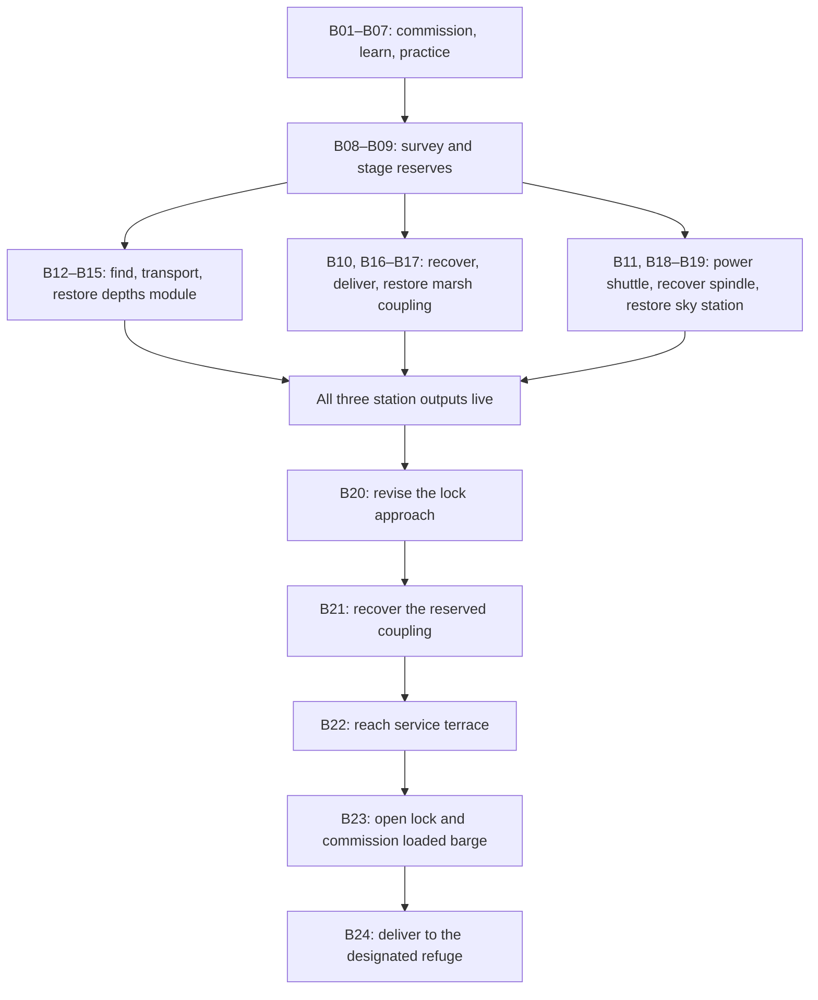

# Skylands: two long-horizon construction and memory tasks

Status: research task specifications with **full-scale executable reference
solutions**, not validated memory benchmarks. Task A has exactly **15 milestones**;
Task B has exactly **24**. The [campaign demonstrations](skylands-campaign-demos.md)
complete 57.9- and 124.4-minute journeys and independently replay every action.
Both have completed GPU Cycles videos with labeled travel timelapse and
[clickable milestone chapters](../assets/demos/skylands-campaign/index.html).
That guide distinguishes implemented mechanics from the broader requirements
and research experiments below. The [compact testbed](skylands-reference-demos.md)
is retained separately for mechanics regression checks.
They extend the original Tears of the Kingdom-inspired
[Skylands: Aster Reach](skylands.md) environment. Names, locations, and assets
are original.

The defining experience is a journey through **sky, surface, and depths**, with
construction, vertical route finding, and reuse of knowledge acquired earlier.
The milestone lists are evaluator specifications, not a walkthrough supplied to
the agent. Objectives describe outcomes; players choose builds and routes.

| | Task A: The Fallen Observatory | Task B: The Three-Layer Lifeline |
| --- | --- | --- |
| Goal | Recover a heavy navigation core from the depths and restore its sky observatory. | Restore three freight stations and deliver a relief shipment to the designated surface refuge. |
| Milestones | 15 | 24 |
| Main abilities | Build powered cargo rafts; scout and use ascent routes. | Both A abilities, plus reverse the recent motion of eligible platforms. |
| Memory demands | Reuse a construction method with a changed load; remember a parked vehicle, a cross-layer landmark, and a calibration. | Select and compose three skills; distinguish similar equipment; remember self-chosen caches; update a route after a visible failure. |
| Final composition | Retrieve the core, ferry it, reach the hoist controls, and raise it to the observatory. | Retrieve a cached coupling, reverse a platform, ascend into a gatehouse, and complete a loaded barge delivery. |

## Shared environment and ability contract

Use the existing layered world as the foundation, expanded into several authored
regions per layer. Sky ruins have distinct silhouettes and underside features;
surface docks, reedbeds, and quarry roads support freight routes; the depths
contain flooded galleries, mineral seams, and service chambers. Landmarks must
remain recognizable from different viewpoints without every location looking
alike. Vegetation, rocks, and functional structures vary by stable entity identity;
visual variation must not consume simulation RNG.

The first version emphasizes construction and exploration. Combat, hunger,
weapon fusion, automatic blueprint reconstruction, and a hard storm deadline
are outside these two designs. Weather or a scheduled machinery failure can
change a route, but should not turn a memory experiment into a speedrun.

| System | Existing foundation | Required for these designs |
| --- | --- | --- |
| Layered traversal | Sky, surface, depths, climbing, gliding, stamina, and per-layer visited maps. | Larger connected regions, distinctive paired landmarks, freight lifts, and validated return routes. |
| Construction | Nearby visible beam manipulation, rotation, static placement, and collision. | Attach/detach, dynamic assemblies, buoyancy, propulsion, steering, load restraint, and energy use. Current face-supported beams do not simulate vehicle stability or structural strength. |
| Ascent | First overhead ceiling within 32 m, at most eight voxels thick; costs 20 stamina; rejects held parts and unsafe/blocked exits. | Authored scouting and maintenance routes, readable exit evidence, and checks that preserve these constraints. Ascent moves the agent and ordinary inventory, never a vehicle or the heavy quest core. |
| Motion reversal | None. | Task B only: target-local recent motion history, preview, reversal, cancellation, and safe rider interaction. |
| Tasks and persistence | One introductory bridge trial and seeded resets. | Milestone predicates, unique cargo, caches, station states, exposure logs, recovery, and full snapshots. |

Before either task, teach the primitive action interface in a separate neutral
orientation: movement, grabbing, joining, steering, ascent targeting, and gauge
reading. Task B also teaches the reversal button. The task itself teaches how
to combine these controls into useful procedures.

**Construction rules.** Expose part mass, buoyancy/load ratings, thrust direction,
connector compatibility, charge, and live trim through inspectable local cues.
Parts have stable IDs. Similar-looking variants have observable distinguishing
features; heavier cargo really changes the required build. A charge socket is
available at each freight staging area. Joining or installing is atomic on
success; failure preserves parts. The agent can disassemble and recover builds.
No correct blueprint or skill macro is automatically added to its memory.

**Reversal rules, proposed for B.** An eligible platform records a bounded recent
trajectory; start with a **20 simulated second** buffer as a pilot parameter.
Reversal moves that platform backward along the recorded poses while the rest
of the world advances normally. It does not restore inventory, health, energy,
station state, or milestone credit. It cannot replay a journey from earlier in
the campaign. Record history continuously, even outside the camera view; preview
is local and available only for a visible, reachable target. Limit reversal to
tagged single-body platforms, with no attachment edits during reversal. Agent
riders follow contact; heavy quest cargo uses freight lifts and vehicles instead.
A new obstacle stops reversal safely. Eligibility, available history, and the
predicted endpoint are inspectable. Training demonstrates insufficient history,
cancellation, and safe dismounts before scored transfer.

## Procedures learned within the episode

These are evaluator descriptions, not instructions injected into the agent's
prompt. Demonstrations show physical effects; subsequent practice gives an
outcome objective without an action recipe.

| Skill | Procedure and applicability | What changes at transfer |
| --- | --- | --- |
| C: build and commission a cargo craft | Inspect the load and route; choose sufficient flotation; join a stable hull; align propulsion; secure cargo; check charge and trim with a short test; revise before the full crossing. Stop and rebalance after an unsafe test. | Payload mass and shape, available hull pieces, connector locations, crossing length, and landing orientation. Multiple assemblies can work. |
| A: find a usable ascent route | Relate the desired upper destination to a lower approach; inspect ceiling thickness, overhead range, and exit evidence; reach a valid launch position with enough stamina; ascend and verify the landing. Recover through an accessible return path. | Offset galleries, layered ceilings, rotated landmarks, and visibly unsuitable nearby exits. Being directly below a map marker is not sufficient. |
| R: use recent motion as a route | Identify an eligible mover and a useful recorded path; check history and endpoint; board when safe; reverse; cancel or dismount at a reachable landing. Wait for a new cycle if the needed trajectory has expired. | Different movers, route timing, lateral displacement, history lengths, and landing geometry. The saved knowledge is a procedure, not an old trajectory. |

Keep physical laws and role cues consistent. Seed landmark pairings, destination
assignments, calibration settings, and available part combinations; all necessary
episode-specific facts must be observable before use. A familiar construction
idea may come from prior knowledge. Only paired memory comparisons can establish
whether this episode's experience improved later performance.

## Task A: The Fallen Observatory — 15 milestones

**Player-facing goal:** “Recover the navigation core beneath Aster Reach and
bring the sky observatory back online.”

The core is too bulky for inventory, gliding, or ascent. It must travel as a real
load through a flooded gallery, a depths freight lift, a surface waterway, and a
sky hoist. The agent can take maintenance shortcuts while arranging transport
for the core. This separation creates planning dependencies between personal
mobility and cargo mobility.

| ID | Milestone | Completion predicate and purpose |
| --- | --- | --- |
| A01 | Take the observatory commission. | Inspect the damaged observatory's work order and receive its service token. The goal identifies the missing core, without revealing its exact depths location. |
| A02 | Restore the workshop cargo raft. | Observe a safe load/trim demonstration, then commission a raft that carries the workshop ballast through a short test. Establishes C experience; a passing test releases the reusable cargo cradle. |
| A03 | Deliver a practice load across the inlet. | Independently build or adapt a second raft with changed parts and load, then deliver the intact practice crate to the supply dock. Immediate C acquisition check; the delivered crate supplies the return raft's fittings. |
| A04 | Open the ascent workshop's upper store. | Inspect the accessible upper/lower views, find a valid launch position, and reach the store's service lever. Establishes A experience and opens access to the survey equipment. |
| A05 | Recover the survey instrument. | Reach a different upper store through an offset ascent route and retrieve the instrument, without procedural hints. Immediate A acquisition check; unsuitable ceiling/exit candidates have readable evidence. |
| A06 | Stage the surface return raft. | Choose one of several viable return docks, fit a raft for the published core mass, test it, and leave it moored and charged there. The evaluator records the agent-chosen location and raft identity. All choices admit a route from the depths lift to the sky hoist. |
| A07 | Locate the buried observatory works. | Use A05's instrument at the surface survey post to expose the seeded surface-to-depths landmark pairing and the observatory's receiver calibration. This establishes evidence for finding the vault and later commissioning the core. |
| A08 | Establish the depths staging dock. | Navigate to the matching depths landmark, install the issued dock lamp, and open the freight-lift loading gate using the service token. The lit staging area becomes a recovery and recharge point. |
| A09 | Open the vault's service entrance. | Reach its upper maintenance ledge and release the door. The intended route applies A to new ceiling and gallery geometry. Record the first delayed A attempt before help or a training revisit. |
| A10 | Extract and secure the navigation core. | Isolate the visibly marked vault cradle, release the unique core, and secure it in the reusable transport cradle. The core remains a physical load; no inventory pickup substitutes for extraction. |
| A11 | Ferry the core through the flooded gallery. | Assemble a craft from local salvage and deliver the intact core to A08's lift dock. Changed payload placement and hull options require C transfer; the workshop raft cannot be carried into this gallery. |
| A12 | Raise the core to the surface. | Secure it on the fixed freight lift, operate the reachable service controls, and unload it into the surface receiving bay. The agent may travel separately; core identity and integrity must persist. |
| A13 | Recover the staged raft and deliver to the sky hoist. | Retrieve A06's raft, ferry the core along the surface waterway, and dock at the hoist's loading berth. Tests an agent-created location binding and reuse with the actual payload. A replacement craft is allowed as a recovery, recorded separately. |
| A14 | Raise the core to the observatory. | Load the fixed sky hoist, reach its elevated control gallery through an appropriate ascent route, and bring the core to the receiving cradle. Agent ascent alone cannot satisfy the cargo predicate. |
| A15 | Restore navigation service. | Install the core, select A07's receiver calibration, and sustain correct beacon output for five simulated seconds. Success requires the original intact core installed and the observatory currently operational. |

**Dependencies.** A02 supplies the cradle needed at A10; A03 supplies A06's
fittings; A04–A05 supply A07's instrument; A07 identifies A08's destination;
A08–A12 establish the core's return to the surface. A06 and A12 converge at
A13, then A14–A15 finish the mission. A06 and the survey preparation can be
interleaved. Enforce requirements through items and world state, never a global
“complete the next milestone” switch.

**Memory opportunities.** A05 → A09 tests ascent transfer; A06 → A11 tests
construction reuse after other work; A06 → A13 tests the chosen dock/raft
binding; A07 → A08 and A15 test cross-layer correspondence and calibration.
A11 and A13 rehearse C, and A09 rehearses A: later uses are composition checks,
not independent tests of the original retention gap. The visible raft may help
reconstruct its design at A13; report this assistance.

## Task B: The Three-Layer Lifeline — 24 milestones

**Player-facing goal:** “Restore the depths, marsh, and sky freight stations,
then deliver the relief cargo to the refuge named in the commission.”

The three stations power the final cargo lock. After commissioning, a signaled
mechanical failure closes its normal maintenance approach. The agent must update
its route, recover equipment stored much earlier, and combine its abilities to
complete a physical shipment. There is no required combat or NPC escort AI.

| ID | Milestone | Completion predicate and purpose |
| --- | --- | --- |
| B01 | Accept the lifeline commission. | Obtain service authorization and observe the designated refuge plus its delivery-channel assignment. These seeded facts remain relevant to the final shipment. |
| B02 | Commission the training barge. | Observe the loaded-craft demonstration and pass a short trim/propulsion trial. Acquire C experience and the standard cargo cradle. |
| B03 | Deliver the independent practice load. | Solve a changed load/part arrangement without a supplied recipe, delivering a crate of service fittings. Immediate C acquisition check. |
| B04 | Open the ascent workshop. | Use inspectable upper/lower views to reach its service controls. Acquire A experience and release the workshop equipment. |
| B05 | Recover the upper-depot service kit. | Independently reach an offset upper depot, avoiding unsuitable ceilings/exits, and retrieve its kit. Immediate A acquisition check. |
| B06 | Restore the moving-platform training route. | Observe local reversal effects and history limits, then ride the training platform to its service landing. Acquire R experience; activate the practice shuttle. |
| B07 | Retrieve the shuttle's survey pack. | Use a different platform with changed timing and lateral motion to recover a survey pack without procedural hints. Immediate R acquisition check. |
| B08 | Survey the three freight regions. | Use the survey pack at the sky lookout to inspect paired sky/surface/depths landmarks and the normal approach to the central cargo lock. The lookout's survey board exposes this evidence locally; it does not add unseen objective coordinates to the agent's minimap. |
| B09 | Distribute the expedition reserves. | Choose eligible caches and stow a bulky depths lamp kit and a final-lock drive coupling in their assigned regions. Record the agent-created item → cache bindings. The transportable loads cannot all fit the expedition carrier at once; capacity is visible. |
| B10 | Recover the marsh-station coupling. | Reach the abandoned surface yard through ordinary traversal and retrieve its unique service coupling. Provides useful intervening work without a C/A/R fixture. |
| B11 | Obtain the sky-shuttle power cell. | Collect and charge the compatible service cell at the lowland quarry, using its visible rating and charging fixture. This supplies the later sky approach without rehearsing reversal. |
| B12 | Establish the depths freight outpost. | Use B08's cross-layer evidence to find the outpost, retrieve B09's lamp kit, light the loading area, and release its power module using service authorization. Tests spatial/episodic retrieval and supplies the depths branch. |
| B13 | Transport the depths power module. | Build a loaded craft from unfamiliar salvage and deliver the module across the flooded works. Delayed C transfer with a different load distribution and landing orientation. |
| B14 | Reach the depths regulator gallery. | Find and use a viable ascent approach above the receiving berth, then open the installation shutter. Delayed A transfer with multiple ceiling layers and a blocked-exit decoy. |
| B15 | Restore the depths station. | Install B12's module and hold valid station output for five simulated seconds. The regional output becomes available to the central lock. |
| B16 | Deliver the marsh coupling. | Transport B10's coupling through the reed channels using a craft adapted to the shallow route. Visually similar hull variants have different visible load ratings; reusing an unsuitable old build is recoverable. |
| B17 | Restore the surface station. | Install the delivered coupling, connect the locally marked output, and hold valid output for five simulated seconds. This is a repair outcome distinct from cargo arrival. |
| B18 | Recover the sky-station spindle. | Power the sky approach shuttle with B11's cell, inspect its current trajectory, and use reversal to reach the spindle's service landing. Delayed R transfer; the required history is generated now, not preserved from B07. |
| B19 | Restore the sky station. | Reach its upper control room by a valid ascent route, install the inventory-sized spindle, and sustain output for five simulated seconds. This reuses A after the depths encounter. |
| B20 | Establish the replacement lock approach. | Once all three stations operate, a visible actuator failure closes the normal maintenance bridge. Inspect the closure and survey a usable alternative via the adjacent moving platform. Updated evidence explicitly supersedes B08's route; another safe approach also qualifies. |
| B21 | Recover and fit the reserved lock coupling. | Retrieve the exact coupling stored in B09's chosen surface cache and install it in the central lock's lower drive housing. Tests a long-lived agent-created binding after several similar equipment encounters. |
| B22 | Reach the lock's service terrace. | Power the local platform from the restored network, inspect its fresh motion history, and reach the terrace by the revised approach. Intended R reuse must respect the new endpoint and the closed bridge. |
| B23 | Commission the final cargo lock and barge. | Ascend from the terrace into the control loft, engage B21's repaired drive, open the cargo berth, and assemble/load a barge from the workshop stock. A short loaded trial must establish safe trim and sufficient charge for the delivery route. |
| B24 | Deliver the relief shipment. | Navigate the loaded barge to B01's designated refuge and unload the intact cargo in its receiving bay. Success requires correct delivery and all three stations plus the central lock currently operational. |

**Dependencies and route choice.** The numbered rows give one reference itinerary.
After preparation, the three station branches can be interleaved. The lamp kit
is retrieved at B12; the separate lock coupling remains cached until B21.
The central workshop supplies barge parts and cargo, so neither must be carried
through an ascent or reversal maneuver.

The graph summarizes a valid itinerary, not permission to gate independent actions
by row numbers. For example, B10 and B11 can be collected earlier if reachable,
and the coupling can be recovered before the bridge fails. Preserve valid early
evidence. Physical station power gates the final lock; a milestone counter does not.

**Memory opportunities.** B03 → B13, B05 → B14, and B07 → B18 are the intended
first delayed skill probes on the reference itinerary. A different branch order
can make B16 or B19 the first C or A probe; derive probe identity and delay from
actual events. B08 → B12/B18 tests cross-layer correspondences; B09 → B12/B21
tests the agent's own cache choices; B08 → B20–B22 tests route updating; B01 →
B24 tests the destination assignment. B22–B24 test composition after rehearsal.

## Milestone scoring, recovery, and alternative solutions

Each completion record contains a stable milestone ID, timestamp, task seed,
relevant object IDs, and evidence from world predicates/events. Credit each
milestone once. Historical achievements can remain latched, but station outputs,
cargo integrity, and final delivery conditions must be checked in the live world.
No reward is paid for repeating a successful delivery or mechanism activation.

Report milestone coverage as completed unique milestones / 15 or / 24, separately
from **mission success**, which is the final live-world goal. A safe alternative
solution can satisfy that goal while bypassing a training or retrieval milestone.
Do not force arbitrary checklist completion or similarity to a reference trace.
If a skill was bypassed, score its probe **not exercised** and report coverage;
do not infer mastery from mission success. A controlled skill probe may require
a physical outcome, but must accept multiple valid constructions and action orders.

Provide recoverable shores, reachable charging, resettable mechanisms, and a
service recovery cradle for unique cargo that falls outside accessible terrain.
Recovery returns that same object to its last valid staging area at a recorded
cost; it cannot duplicate it or advance delivery. Stored vehicles and cache
contents persist. Poor builds consume time and energy, but critical items are
not irreversibly destroyed. Agent death still terminates the attempt; the time
budget truncates it. Validate capacity constraints and every allowed cache choice
so they cannot create a softlock.

Author connected loading ramps and dock approaches for every heavy-cargo leg.
In A, the surface receiving bay shares a navigable inlet with all eligible return
docks, and the hoist unloads directly into the observatory cradle. In B, the lock
coupling is installed at ground level before the agent takes the platform/ascent
route; opening the berth also opens a walkable route back to its loaded craft.
Never require cargo to follow an agent-only traversal ability implicitly.

Local feedback includes gauges, failure causes, visible service signs, and valid
target previews. Evaluator-only fields include hidden cache bindings, future
milestone predicates, unseen station states, and correct calibration answers.
Audit observations, HUD, text, maps, rewards, `info`, and events for leakage.
An automatic quest log that repeats old clues is an external memory condition,
not a memoryless baseline. Existing per-layer visited maps must be held constant
across comparisons and reported as built-in spatial memory.

## Testing memory rather than just completing a long quest

Use the acquisition → independent practice → intervening work → changed-instance
reuse structure above. Record first-attempt behavior, eventual success, retries,
source revisits, charge/part costs, and unsafe-precondition attempts. A loaded
departure beyond the test dock, an ascent activation, and a reversal activation
are the respective consequential-attempt boundaries. Inspection is not an error.

At each transfer, measure time since both first exposure and **last relevant
rehearsal** in decisions, simulated seconds, and observed context volume. Only
call a probe long-retention if its supporting experience is outside the declared
recent-context window. Do not infer a long memory gap from milestone count.

From identical pre-transfer world snapshots, compare a fixed recent-context
agent with the same agent using bounded episodic records, agent-authored procedure
notes, or both. Add an unrelated-memory control and a separately labeled correct
procedure reference. Match ordinary context, action budgets, and storage/retrieval
budgets where applicable. A procedure reference supplies no hidden cache location,
calibration, or destination. Remove duplicate withheld information from histories,
notes, tool caches, and hidden controller state. Restore physics, assemblies,
RNG, timers, station state, and reversal buffers exactly.

Use held-out geometry, part sets, loads, landmark pairings, and clue assignments.
Report acquisition failures, transfer conditional on acquisition, probe coverage,
and uncertainty across seeds. The evidence for useful memory is improved behavior
under these paired comparisons, not plausible written notes. Cache first-choice
accuracy and search cost, wrong route attempts after the update, and correct
refuge delivery are separate episodic/spatial measures.

Task B changes both length and complexity. **A-versus-B success is not a pure
horizon comparison.** To measure degradation as memory accumulates, branch the
same frozen skill probes with matched retention delay, candidate-cache count,
and recent context, varying only the amount and relevance of earlier stored
experience. Label this a diagnostic condition, not extra quest milestones.

Provisional pilot budgets are **30–60 simulated minutes for A** and **60–120 for
B**: 9,000–18,000 and 18,000–36,000 decisions at the current default 0.2 seconds
per decision. These are design targets, not measured completion times or fixed
benchmark limits. Set final budgets after legal reference rollouts; useful
construction and logistics should create the horizon without empty waiting.
Optional session boundaries are after A08 and B12, preserving only the declared
agent memory plus complete world state. Checkpoint/resume remains new work.

## Implementation order and presentation

1. Implement a loaded-raft fixture and validate buoyancy, joints, cargo transport,
   energy, and recovery before claiming construction competence. Expand part
   selection beyond the current eight-row construction observation as needed.
2. Implement A's authored ascent fixtures, unique core, fixed freight lifts,
   chosen return dock, and milestone evaluator. Produce one complete legal
   rollout, then held-out variations and memory comparisons.
3. Add and independently validate platform reversal, including expired history,
   rider collisions, cancellation, obstruction, and deterministic snapshots.
4. Add B's three independent station branches, caches, signaled route change,
   and final delivery. Validate alternative branch orders, cargo loss recovery,
   and final-state checks before collecting benchmark scores.

A scene with static bridge blocks is still a construction prototype; it does
not validate either proposed task. The separate full-scale campaign classes now implement executable reference
journeys; they preserve the original introductory environment. Their validated
traces establish executability, while the remaining benchmark requirements above
need separate evaluation.

Future user-facing previews should use Blender Cycles with recorded renderer,
device, resolution, samples, and scene/trace identity. The reference implementation now exports Skylands scenes, including task
mechanisms and depths lights, to Cycles. The standalone `render_blender` command
still lists Teyvat/Wildlands; the reference recorder is the supported Skylands
video entry point. Native Skylands images must be labeled as native
renders and must not stand in for Cycles previews. Preserve actual geometry,
collisions, cargo, and action traces; terrain/collision changes require new
ground-truth validation. Headless logic tests may use inexpensive observations.
