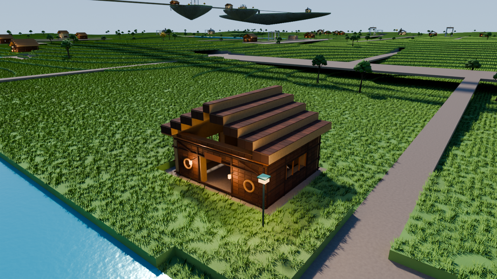
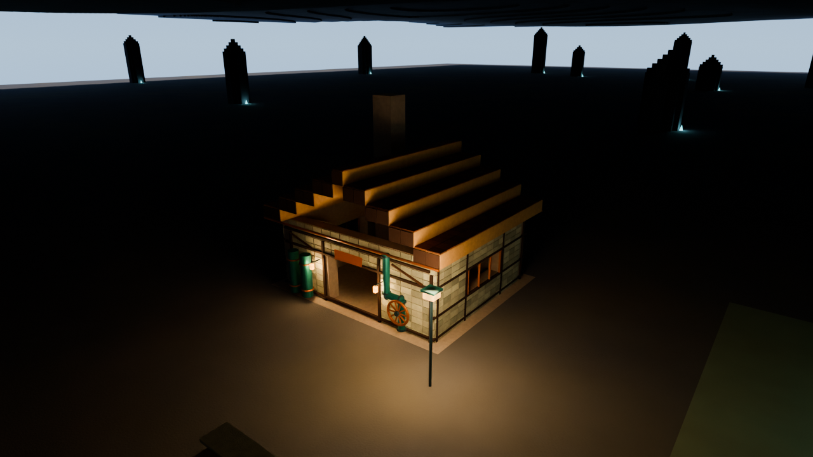
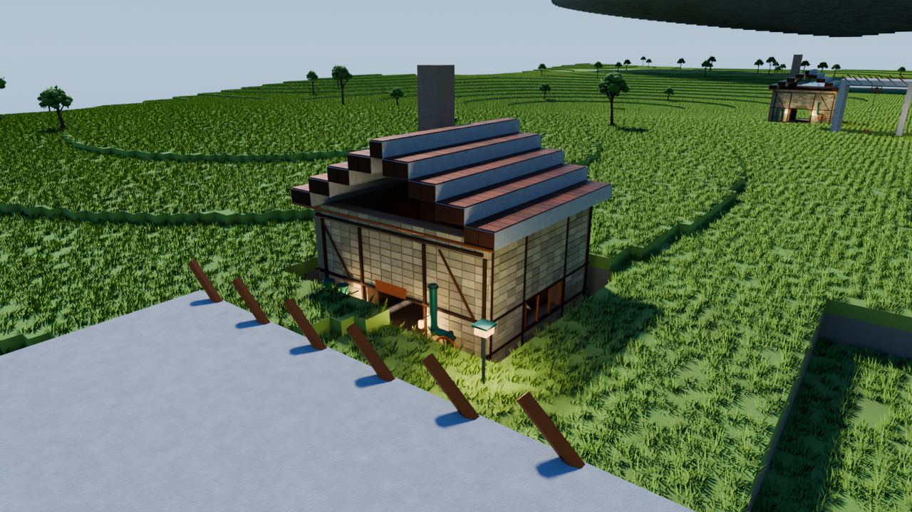
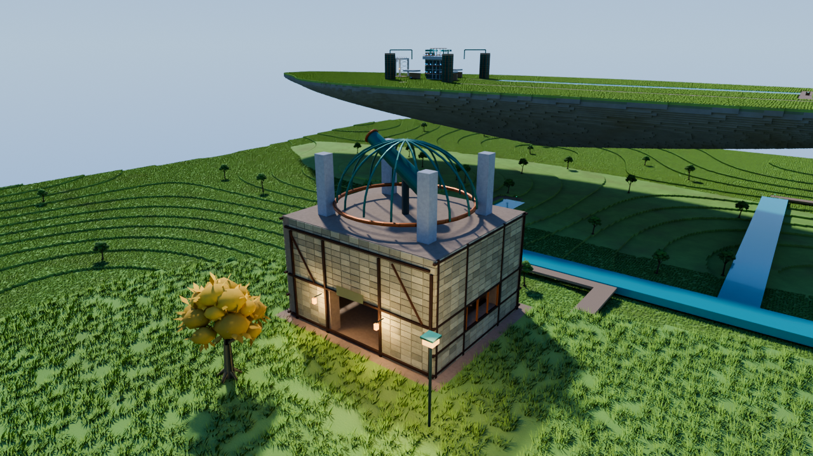
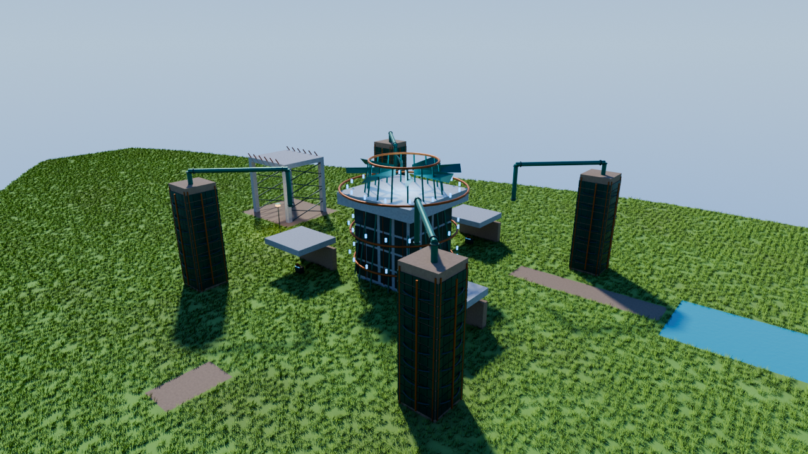

# Skylands — Silence the Tempest Engine

An original objective-driven campaign built on the full Skylands regional world.
The runaway atmospheric engine, industrial settlements, service records and
shutdown encounter are original procedural designs. No commercial game assets,
dialogue, characters, maps or quest scripts are included.

## Verified runs and previews

**94 regression and task checks pass.** Four complete reference solutions have
been executed and independently replayed against the final simulator. No deaths
occurred. The two open runs complete with **zero regional milestones**.

| Objective / seed | Shutdown method | Regional order | Simulator actions | Simulated duration |
| --- | --- | --- | ---: | ---: |
| Extended / 7 | Synchronization | Monitoring → anchors → cooling | 42,818 | 2 h 22 min 43.6 s |
| Extended / 23 | Grounding cartridge | Anchors → cooling → monitoring | 43,856 | 2 h 26 min 11.2 s |
| Open / 7 | Exposed capacitors | No regional preparation | 3,311 | 11 min 2.2 s |
| Open / 23 | Grounding cartridge | No regional preparation | 3,941 | 13 min 8.2 s |

These are measured reference itineraries, not shortest-path bounds or model
results. The initial 3–6-hour target remains unestablished; the implemented
extended references currently take about 2.4 simulated hours.

Evidence: [validation summary](../assets/demos/skylands-tempest/validation-summary.json),
[test report](../assets/demos/skylands-tempest/tests.xml),
[extended synchronization replay](../assets/demos/skylands-tempest/extended-seed-7/verification.json),
[extended grounding replay](../assets/demos/skylands-tempest/extended-grounding-seed-23/verification.json),
[early capacitor route](../assets/demos/skylands-tempest/open-capacitors-seed-7/verification.json),
[early grounding route](../assets/demos/skylands-tempest/open-grounding-seed-23/verification.json).
Each run directory also contains its complete `actions.jsonl` and source-hashed
`reference-manifest.json`. Re-executed reference candidates preserve every
recorded position; independent verification then starts again from a fresh reset.

The gallery below shows the **actual reset-state world in GPU Cycles**, with
camera-only framing. It is not a recording of agent behavior. Full-resolution
PNGs, image hashes and [renderer settings](../assets/demos/skylands-tempest/showcase/renderer-report.json)
are preserved alongside the [presentation verification](../assets/demos/skylands-tempest/presentation-verification.json).

| Shipwright's boathouse | Underground cooling works |
| --- | --- |
|  |  |

| Anchor foundry | Sky observatory |
| --- | --- |
|  |  |



Eight additional [replay-state previews](../assets/demos/skylands-tempest/trace-previews/scene-manifest.json)
come from the verified extended run, including the [engine after shutdown](../assets/demos/skylands-tempest/trace-previews/000007.png).
Their camera framing emphasizes architecture while preserving the agent's actual
position and machine state. The gallery above uses the seed-7 open objective's
reset state; it shares the same world geometry.

## Objectives and alternatives

| Variant | Agent's objective | Success predicate |
| --- | --- | --- |
| Open | Find and stop the runaway atmospheric machine. | Agent alive; engine stopped for five simulated seconds. |
| Extended | Stop the machine, restore cooling/anchors/monitoring, and deliver relief to the commissioned refuge. | Open predicate plus intact regional components installed at their actual stations, stable outputs, and the original intact relief shipment at the designated receiving dock. |

The agent receives the objective, its sensors and inventory, locally visible
target IDs, and short-lived interaction feedback. It does **not** receive the
reference itinerary, a next-milestone prompt, unseen target coordinates, hidden
selector settings, regional completion flags or evaluator milestone telemetry.
Inspecting the weather archive can legitimately reveal a destination. Records
can be revisited, and local machine feedback is always available.

The existing 24 logistics outcomes remain private diagnostic milestones. None
are an all-or-nothing checklist for the open objective. The extended objective
requires live outcomes rather than completion of every training activity.
Regional branches can be interleaved or reordered after their physical equipment
dependencies are met. The final encounter can be attempted immediately.

Three shutdown methods are implemented:

* **Synchronize:** discover three seed-dependent service settings, return to the
  machine, and isolate each circuit while its shutters vent. Settings come from
  the sky weather archive, deep pump intake and quarry charging yard.
* **Ground:** assemble a rated cargo craft at the sky salvage canal, secure the
  unique 240 kg grounding cartridge, steer it to the receiving dock, tow it to
  the socket and install it. Cargo cannot accompany character ascent.
* **Break exposed capacitors:** strike each exposed capacitor during venting,
  respecting the tool recovery interval. This supports a difficult early route
  without the regional repairs or a supplied artifact weapon.

After isolating the circuits or grounding the machine, operate its shutdown
lever. Waiting alone, remotely selecting an ID, claiming a milestone or moving
a substitute cargo object cannot complete the task.

## Preparation changes the encounter

The machine has a sixteen-second warning/discharge/pressure/vent cycle. Its
phase offset and three selector settings vary with the world seed. Visible
shutters and local text expose the current phase; the monitoring station also
broadcasts it remotely.

| Operating infrastructure | Effect |
| --- | --- |
| Deep cooling works | Extends the vent window from four to nine simulated seconds. |
| Surface anchor works | Reduces exposed discharge damage from 0.45 to 0.08 per decision. |
| Sky monitoring station | Makes the current machine phase observable away from the arena. |

Overhead service-bay roofs provide physical shelter. Incorrect selector settings
cause a small fault injury and preserve already isolated circuits. Restored
infrastructure is checked from live cargo, installation and output state rather
than a historical achievement flag. The boss is a mechanical hazard encounter,
not a humanoid combat or companion-AI system.

## Architecture and presentation

The campaign includes **50 structures across ten families**: boathouses, pump
houses, foundries, gantries, observatories, archives, workshops, shelters,
cisterns and signal towers. Their walls, floors, roofs, openings, supports and
the engine arena are authored into collision geometry before reference runs.
Side plots avoid existing routes and interaction fixtures.

Cycles presentation adds individual masonry courses and roof plates, timber
framing, copper plumbing, flanges, valves, pressure vessels, pulley wheels,
lifting cables, telescope cages, shelving, crates, lanterns and fabric signs.
The engine has turbine blades, conductor rings, heat-exchanger pipes and
state-dependent indicators. These detailed meshes are procedural geometry,
not composited illustrations. Fine trim and machinery detail are decorative;
the collision model remains voxel based.

Asset variation is keyed to stable world/entity identity using a dedicated seed.
Camera movement cannot change an object's appearance. Presentation does not
consume the simulation RNG. The full-world exporter retains every terrain face,
tree and high-tier ground-cover instance; coplanar face merging is lossless.

User-facing previews use **Blender Cycles, OptiX GPU, 1280 × 720, 64 samples,
denoising and six light bounces**, with no CPU fallback or resolution upscaling.
Architecture showcase stills use the recorded campaign's exact reset state.
The optional trace-preview exporter uses independently replayed action states.
Neither is a continuous recording. Camera framing may emphasize architecture,
but never moves the agent or edits the simulation. Scene/image hashes and
renderer/device settings accompany the artifacts.

## Run

Use the native Gymnasium interface. The older shared schema-2 adapter lacks the
target/option controls needed by campaign mechanisms; it is not an adapter for
this task.

```python
import gymnasium as gym
import owb

env = gym.make("OpenWorldBench/Skylands-Tempest-v0", seed=7,
               render_enabled=False)  # Explicit headless logic mode.
obs, info = env.reset(seed=7)
print(obs["text"])
print(env.unwrapped.commands)
```

Use `OpenWorldBench/Skylands-Tempest-Extended-v0` for the extended objective.
`render_enabled=True` adds native policy RGB observations; native sensor rendering
is distinct from the GPU Cycles presentation renderer. Movement, gliding and
ascent retain the [Skylands control contract](skylands.md). Campaign actions
add `inspect`, `pick`, `mount`, `turn_part`, `load`, `unload`, `drive`, `use`,
`take`, `cache`, `retrieve`, `reverse`, `cancel`, `haul` and `release`.
`target` selects a locally observed object ID; `option` selects a mount, setting
or locally described alternative. `nearby` has 32 rows containing visibility,
target ID and relative XYZ; unused rows are zero. Controls should be taught in
a separate neutral orientation before measuring exploration.

Refuge receiving pads also accept the original intact relief cargo through a
local `use` interaction. This supports alternative physical delivery routes and
delivery after shutdown; scoring does not require the reference cargo-lock flags.

Collect and independently replay reference solutions in fresh directories:

```bash
OPENBLAS_NUM_THREADS=1 python -B -m owb.scripts.skylands_tempest collect \
  --objective extended --route synchronization --order monitoring anchors cooling \
  --directory /tmp/tempest-extended
OPENBLAS_NUM_THREADS=1 python -B -m owb.scripts.skylands_tempest verify \
  --directory /tmp/tempest-extended
OPENBLAS_NUM_THREADS=1 python -B -m owb.scripts.skylands_tempest collect \
  --objective open --route grounding --seed 23 --directory /tmp/tempest-grounding
```

The reference uses privileged state to plan, but changes the environment only
through legal actions. Replay starts at a fresh reset and compares every action's
position, reward, events and termination, intermediate state digests and the final
live objective. These runs establish executability, not learned-agent competence
or memory benefit. Report measured simulated time and low-level actions separately
from high-level decisions, model calls, tokens and wall time. Shortcuts mean the
open variant has no guaranteed minimum successful horizon.

## Persistence and evaluation

`env.save_checkpoint(path)` writes a checksummed, non-executable JSON action-log
checkpoint. `SkylandsTempestEnv.load_checkpoint(path)` replays it and verifies
the complete final state before returning. Restoration cost grows with the action
prefix; it is not an O(1) snapshot. Matching simulator source is required.
Agent-authored memory is separate and must be preserved or ablated explicitly by
the experiment runner; the checkpoint does not manufacture memory notes.

`env.evaluation()` provides private diagnostics: regional outputs, milestone
timestamps, records inspected, shutdown method, action count, simulated duration,
deaths and architecture counts. Keep it out of policy context. Task success,
memory causality, planning efficiency and motor-control cost are separate results.

The full campaign is authored rather than a held-out geometry distribution.
The freight model uses rated four-mount craft and collision-backed grid motion,
not arbitrary welded rigid bodies. Broader alternative construction, recovery
and held-out layout coverage, automatic model-policy evaluation and paired memory
experiments remain research work. No 3–6-hour minimum or learned-agent success
rate is claimed without measurement.
