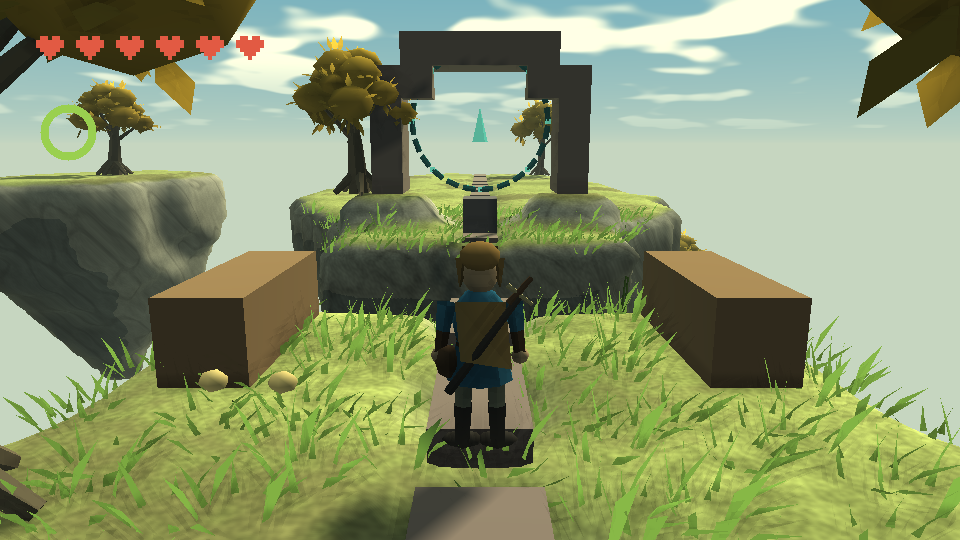
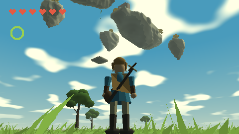
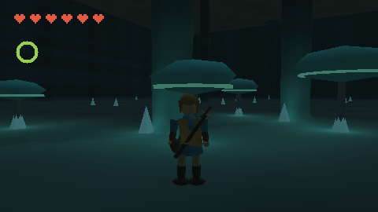

# Skylands: Aster Reach

Skylands is an original Tears of the Kingdom-inspired environment built on OWB's
voxel physics and CPU landscape renderer. The first course contains three connected
layers: floating meadows, the surface below, and a crystal cavern. It is runnable
through Gymnasium and the shared agent/recording interface.

The [long-horizon task designs](skylands-long-horizon-tasks.md) propose a
15-milestone core-recovery expedition and a 24-milestone freight-restoration
campaign. They specify construction, cross-layer memory, and delayed skill reuse;
[full-scale reference implementations](skylands-campaign-demos.md) now complete
both journeys in 57.9 and 124.4 simulated minutes, with independent action replay
and completed [GPU Cycles walkthroughs with milestone chapters](../assets/demos/skylands-campaign/index.html).
The videos cover the full campaigns with labeled travel timelapse.
The guide describes their cargo-craft,
reversal, rendering, and research limitations. A separate
[compact testbed](skylands-reference-demos.md) remains available for mechanics checks.



The visual pass adds irregular island outlines and tapered stone undersides,
golden canopies, hanging vines, worn masonry paths, satellite islands, a ruined
arch and segmented relic. Surface trees and a turquoise basin sit below the
islands. The depths have basalt pillars, luminous crystals, fungi, local lights,
and cooler ambient lighting. These are procedural engine geometry and materials;
no generated artwork or game assets are composited onto agent observations.

| Surface view | Crystal depths |
| --- | --- |
|  |  |

## Run and record

```bash
pip install -e ".[dev,video]"
python -B -m owb.scripts.benchmark --env skylands --seed 7 --steps 45 \
  --size 384 216 --policy demo --video gif --output /tmp/owb-skylands-demo
python -B -m owb.scripts.screenshots --environment skylands
```

The fixed-course demo grabs and places two beams, walks across them, and activates
the beacon. It uses the same interface as other policies. It is a showcase of this
course, not a general construction or memory baseline. Each recording directory
must be new. `--quality presentation` adds supersampling for higher quality.

To capture the other layers, add `--skylands-layer surface` or
`--skylands-layer depths` to the screenshot command. Screenshots use fixed showcase
cameras in the full world; regular agent observations default to first person.
Use `--size 480 270 --skylands-quality fast` for cheaper captures (used for the
surface/depths previews above); the main preview uses the default 960 x 540 view.
The `small` variant is 48 x 64 x 48 voxels; `full` is 96 x 96 x 96 (x, y, z).

```python
import owb
from owb.bench import COMMANDS, neutral_action

with owb.make_env("skylands", seed=7) as env:
    obs, info = env.reset()
    action = neutral_action()
    action["command"] = COMMANDS.index("grab")
    action["part"] = 1
    obs, reward, terminated, truncated, info = env.step(action)
```

Native IDs are `OpenWorldBench/Skylands-v0` and
`OpenWorldBench/Skylands-Small-v0`. Native configuration is `owb.EnvConfig`.
Native commands are exported by `owb.sims.voxel.env.skylands.COMMANDS`; their indices differ
from the common schema. Skylands supports only the native `multi` action mode.
`obs_rgb=False` disables automatic rendering in native rollouts.
World generation uses dimensions and seed; Wildlands terrain presets and density
settings do not apply to this introductory course.

## Construction and ascent

Existing survival movement, gliding, climbing and inventory controls are retained.
The common interface is now **schema 2**, with these additions on all backends:

| Control | Behavior in Skylands |
| --- | --- |
| `grab` command | Pick up a visible part within 9 m of the agent's eyes. |
| `part` | `0` chooses the nearest reachable part; `1..8` selects a stable part ID. |
| `build_move` | Three floats in `[-1,1]`, ordered east/up/south. Values with magnitude at least 0.5 move the held anchor one voxel along that axis per decision. |
| `rotate` command | Rotate the held beam 90 degrees around its lower corner. |
| `place` command | Fix the held beam into empty voxels, touching an existing solid face. |
| `ascend` command | Pass through the first overhead ceiling within 32 m, at most eight voxels thick, for 20 stamina. |

Held movement happens before the command, once per decision regardless of physics
frame skip. The preview stays in world space when the agent walks. It can overlap
terrain while being positioned; placement checks bounds, range, line of sight,
occupancy, agent overlap, and face support. A failed placement preserves the held
part and terrain. Placed beams are real collision geometry; agents can walk on
them. The preview is turquoise when placeable and orange otherwise.

Ascend requires a clear exit for the entire agent body and rejects liquid/fire
exits, excessive thickness, insufficient stamina, or a held part. A shaft connects
the surface and depths. The full world has an intermediate ascent platform;
gliding controls descent. Weather, wind and fire spread default off for this course.

## Observations and task semantics

`construction` is an `(8,9)` float array. Rows correspond to part IDs 1–8; columns
are `visible, held, relative_x, relative_y, relative_z, size_x, size_y, size_z,
quarter_turn`. Relative positions describe the part center relative to the agent's
feet in world-axis coordinates. Unseen parts are zero-filled. Visibility requires
line of sight and a distance of at most 14 m, without a camera field-of-view filter.
The held part remains observable as manipulation state.

`build_state` contains six floats: held part ID (0 if empty), held anchor offset
from the agent's feet (x/y/z), placement validity, and altitude layer (0 depths,
1 surface, 2 sky). Field names are exported from `owb.sims.voxel.sim.construction`.
Each layer has independent visited-cell memory; `minimap` shows only the current
layer. Changing altitude does not reveal cells in another layer.

The trial succeeds only after a walkable bridge connects the two island lips,
the agent reaches the far island on foot, and it interacts with the nearby beacon.
Success gives 10 reward and terminates. Death terminates; the time limit truncates.
Terminal success/death takes precedence over a coincident time limit. Native
exploration rewards remain enabled unless `reward_mode="sparse"` is selected.
`task_progress` is 0 before the bridge, 0.5 when connected, and 1 on success.
Info includes structured construction events and per-layer visit counts.

Same-seed resets reproduce terrain, scenery, part IDs, and action outcomes. Render
calls do not consume the simulation RNG. Both renderers provide aligned RGB,
depth, and semantic buffers; `style="voxel"` retains the block-debug view.
Skylands uses exact voxel tracing at distance so floating architecture stays
suspended; landscape rendering also preserves the space beneath distant ruins.

## Current limits

Construction uses finite, grid-aligned, static beams. There are no dynamic welded
assemblies, motors, batteries, recall, fusion, saved blueprints, or cross-session
checkpoints yet. Placement has a local face-support check, not structural load
simulation; removing a supporting part does not collapse other placed parts.
The three layers share one finite voxel world. This is a seeded introductory
course, not a validated long-horizon memory task suite.

Rounded foliage, fungi, and the suspended relic are approximate visual geometry;
terrain, arch masonry and placed beams retain voxel collision. The relic is
decoration; the beacon below it is the interaction target. CPU rendering at large
resolutions can be slow. Use smaller frames for training.

```bash
PYTHONDONTWRITEBYTECODE=1 python -m pytest -q -p no:cacheprovider tests/test_skylands.py tests/test_framework.py
```
