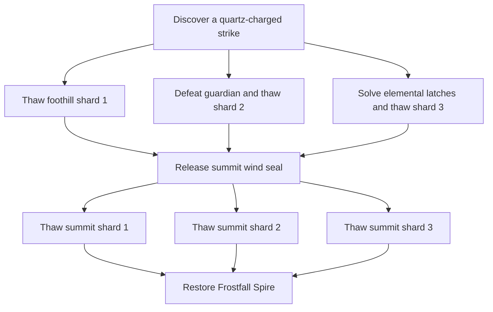
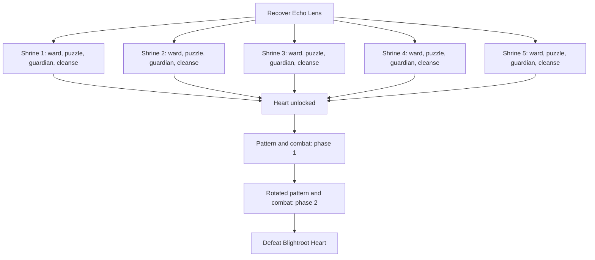
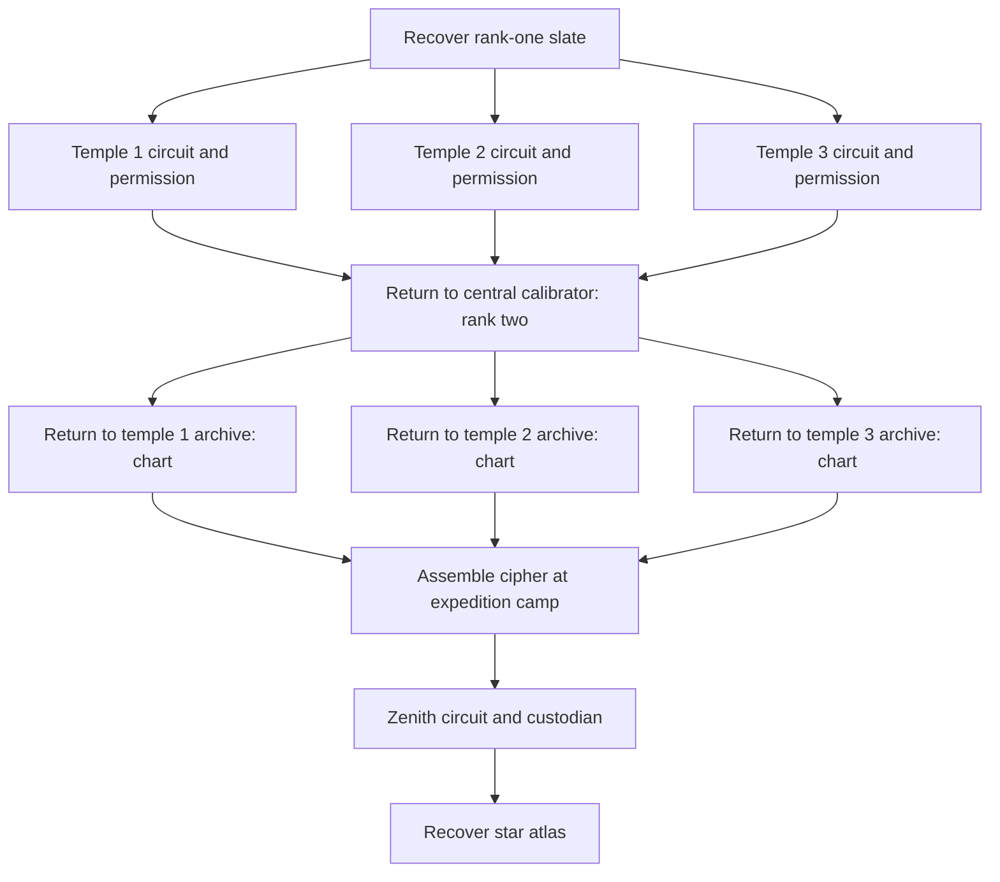

# Teyvat: branching long-horizon campaigns

Suite version: `teyvat-campaign-v1`.

Three playable, original campaigns adapt the mountain expedition, multi-shrine
cleansing, and desert-clearance structures described in the design request.
The agent receives one final goal and must discover local mechanics, choose a
branch order, retain information, and satisfy persistent world prerequisites.
There is no current-step pointer or global waypoint supplied to the policy.

These are research adaptations inspired by *In the Mountains*, *Sacred Sakura
Cleansing Ritual*, and *Golden Slumber / Old Notes and New Friends*. They use
original names, geometry, and mechanics, with no game assets or code. They do
not reproduce the original games' quest scripts.

| Proposed tier | Task | Final goal | Persistent milestones | Main demands |
| --- | --- | --- | ---: | --- |
| Easy | `summit` — Frostfall Spire | Restore the summit spire | 9 | Exploration, cold management, quartz discovery, combat, elemental latches, delayed reuse |
| Medium | `cleansing` — Fivefold Cleansing | Defeat the Blightroot Heart | 17 | Five independent branches, local wards, reusable puzzle procedure, two boss phases |
| Hard | `desert` — Zenith Archive | Recover the lost star atlas | 15 | Permission upgrades, charge budgeting, cross-region returns, chart assembly |

The tiers are design hypotheses, not measured model difficulty. The desert has
fewer milestone receipts than cleansing but longer spatial dependencies and
additional resource/permission constraints. We do not pad milestone counts to
make a task appear harder.

## Mountain: Frostfall Spire

**Goal:** “Restore the Frostfall Spire at the mountain summit.”



Each shard requires **two separately charged physical hits**. Interacting with
crimson quartz grants one hit that expires after 45 simulated seconds; it does
not become an unlimited inventory weapon. Quartz regenerates after two seconds,
so mistakes are recoverable. Native swing cooldown, range, and facing apply.
One lower shard also requires defeating its guardian, and another requires a
seeded three-element latch sequence read from a local inscription. These are
actual completion conditions, not extra counters.

Cold accumulates away from braziers. At maximum cold it damages the character;
nearby heat reduces cold, and interacting with a brazier clears it. The three
lower shards can be completed in any order. Their conjunction enables the wind
seal console. Upper shards reject charged hits until the seal is released, even
if an agent navigates around the visible doorway early. The upper shards reuse
the quartz rule at new locations before the final spire becomes usable.

Milestone IDs: `charged_strike`, `lower_0..2`, `ascent`, `upper_0..2`, `final`.
The first charged hit demonstrates discovery; it does not finish a shard.

## Cleansing: Fivefold Cleansing

**Goal:** “End the valley blight by defeating the sealed Blightroot Heart.”



The Echo Lens reveals a shrine-specific ward at each echo statue. Each ward is
unique and consumed at its matching socket. Repeating an interaction cannot
duplicate it, and a different shrine's ward does not work. The local tablet
specifies a seeded ordering of ember, tide, and gale. Receiver positions are
shuffled separately, so the procedure applies to roles rather than a fixed
movement sequence. Applying an incorrect element/order resets the lamps while
preserving the installed ward; the agent can inspect and retry.

Only a solved pattern exposes the shrine guardian. Native damage cannot brute
force the seal. After defeating the guardian, interacting with the altar
permanently cleanses that shrine. All five branches are available after the lens;
there is no prescribed shrine order.

The Heart opens only after all five cleansings. Its two 80-HP phases each need a
puzzle solution and combat during a 20-second exposure window. Phase two rotates
the tablet order. Damage is capped at the remaining phase HP, so a large attack
cannot skip the second puzzle. An expired window can be opened again.

Milestone IDs: `lens`; `shrine_0..4_ward`, `shrine_0..4_puzzle`,
`shrine_0..4`; `final`. The two boss phases are mechanically enforced subconditions
of the final milestone, and their exposure windows are recorded separately.

## Desert: Zenith Archive

**Goal:** “Recover the lost star atlas from the sealed Zenith Archive.”



The slate starts with rank-one clearance and six charge units. Attuning a socket
costs one charge, reading a tablet costs one, and opening an archive costs two.
Field and camp obelisks restore charge without consuming a finite supply, so a
poor budget requires additional travel rather than permanently breaking the run.

Each temple supplies a separate permission mark after its puzzle and guardian.
All three marks are required at the central calibrator for rank two. The temples'
archives reject rank-one clearance, requiring return trips after the upgrade.
Three unique charts then unlock the camp cipher desk, followed by the Zenith
puzzle, custodian, and atlas. Charts and permissions are persistent credentials;
wards and quartz are consumable, while slate charge is renewable.

The evaluator counts archives approached while locked and subsequently opened,
so observed revisits can be distinguished from merely visiting a location for
the first time after clearance. This diagnostic is not a memory-performance
score. The reference controller deliberately encounters the locked archives
before upgrading.

Milestone IDs: `slate`; `temple_0..2_puzzle`, `temple_0..2`; `rank_two`;
`temple_0..2_record`; `atlas_key`; `zenith_puzzle`; `zenith`; `final`.

## Observation, controls, and scoring

- **Policy observations:** RGB, native proprioception and party state, a constant
  final-goal instruction, and local text. Local text contains the agent's pack,
  cold/coating/slate charge when applicable, recent interaction feedback, and up
  to five visible nearby entity labels/ranges. Visibility is bounded by distance,
  approximate camera field of view, terrain, and architecture occlusion.
- **Memory:** interaction feedback expires after five simulated seconds. There
  is no automatic global journal, saved procedure, full map, or future-step list.
  The expedition keeper supplies local introductory instructions when approached;
  tablets can be revisited. Ordered glyph names are exposed through interaction
  text; this version does not require reading inscriptions from pixels alone.
  An agent may maintain its own permitted memory.
- **No target oracle:** the native task vector and shared adapter goal vector
  are zero. The quest engine has one terminal receipt with no target position.
  Site tables, coordinates, sampled solutions, and the full dependency graph
  are evaluator state, not policy observations. `info` carries evaluator events
  and progress diagnostics; model prompts must use observations, not `info`.
- **Actions:** ordinary movement, camera look, jump/glide, interact, attack,
  sprint/climb, elemental skill/burst, and party swap. There is no navigate-to,
  complete-milestone, teleport, or select-target action.
- **Reward:** zero until final success, then +1. There is no intermediate,
  distance, discovery, or damage shaping. Native death and the step limit can
  end an unsuccessful episode. Stepping after termination requires a reset.
- **Diagnostics:** completion receipts and timestamps, distance, invalid
  applications, blocked interactions, quartz expiry, cold damage, recharge
  visits, archive revisits, and boss exposure windows. Every receipt checks its
  prerequisites; the final verifier checks receipt order, site conditions,
  phase completion, and resource accounting.

A branch is eligible as soon as its prerequisites hold; it does not wait for an
arbitrary numbered operation. Solved circuits, defeated guardians, obtained
permissions, and consumed items persist while the agent travels elsewhere.

## World and presentation

The native environment defaults to geography scale 2: a 1,280 m square regional
heightfield. The shared `variant="full"` selects that scale; `variant="small"`
selects scale 0.5, a 320 m square compact layout for tests. Local interaction
distances remain fixed while regional travel distances scale.

Snowy slopes use timber buildings, windmills, and watchtowers; forest shrines use
open pavilions; desert ruins use towers, stone gate frames, and permission seals.
These build on the existing mixed architecture system. Dedicated meshes identify
ice, quartz, hearths, tools, tablets, seals, and the spire. Stable entity identity
controls appearance without consuming simulation RNG. The native renderer and
Cycles exporter use the same fixtures and active seal dimensions. Closed seals
participate in collision; task conditions also enforce clearance independently.

User-facing screenshots and videos use **Blender Cycles** through the existing
scene exporter. The validation command below intentionally produces no images:
headless zero-RGB observations keep logic tests inexpensive. Any future render
must retain the recorded terrain, collision geometry, camera/action state, and
renderer/settings metadata. A Cycles render does not change the scope of the
simulator: these are authored heightfield regions, not a production open world
with underground interiors, a full economy, or the original game's combat.

## Run the tasks

```python
import owb

env = owb.make_env("teyvat", task="cleansing", variant="full", max_steps=40_000)
obs, info = env.reset(seed=7)
# Pass obs to an observation-only policy; info is evaluator data.
```

The shared factory accepts `task="summit"`, `"cleansing"`, or `"desert"`.
Omitting `task` preserves the previous sandbox behavior. Native Gym IDs are
`OpenWorldBench/Teyvat-Summit-v1`, `OpenWorldBench/Teyvat-Cleansing-v1`, and
`OpenWorldBench/Teyvat-Desert-v1` (import `open_world_bench` to register).

```bash
# Privileged feasibility controller: native actions, no world writes or API calls.
# Produces source hashes, geometry hashes, actions, summaries, and exact replay checks.
python -m owb.scripts.teyvat_campaign --seed 7 --scale 2 \
  --output assets/evaluation/my-teyvat-full-run

# Different branch order and seed in a compact logic-validation map.
python -m owb.scripts.teyvat_campaign --seed 19 --scale .5 --reverse \
  --output assets/evaluation/my-teyvat-alternate-run

# Replay an individual recorded episode with matching source files.
python -m owb.scripts.teyvat_campaign \
  --verify assets/evaluation/my-teyvat-full-run/desert-seed-7-forward
```

The benchmark CLI also accepts `--env teyvat --task cleansing --variant full`;
choose the policy/model and action budget using its existing options. Reference
traces contain privileged information and must remain outside policy context.

## Validation and research scope

See [validation results](teyvat-campaign-validation.md) for checked seeds, orders,
action counts, simulation time, and replay artifacts. The reference controller
reads hidden state for routing and planning, then emits only native controls.
The recorder checks that calling the controller does not change simulation
state. A fresh environment independently replays every action and compares exact
positions, events, rewards, end flags, and state digests, including character,
camera, party cooldowns, elemental state, inventory, mechanism state, and RNG.
Static terrain, scenery, architecture, and gate definitions have a separate hash.

This establishes feasibility and deterministic replay for the checked cases.
It does **not** establish observation-only solvability by a particular model,
learned exploration, skill acquisition, or memory benefit. The templates and
regional arrangement are fixed with seeded local positions, patterns, and
appearance; broad procedural topology generalization remains future work.

For a memory study, compare matched seeds, action budgets, decision intervals,
and observation modalities under no persistent memory, episodic memory,
procedural memory, and combined memory. Proposed fresh-context checkpoints are
after the lower mountain shards, after initial shrine mastery, and after the
desert clearance upgrade, retaining the world and only the allowed agent store.
These context resets and memory ablations are a proposed evaluation protocol,
not automatically executed by the environment. Record acquisition first, actual
time since last reuse, branch order, revisit travel, and terminal success; a
failed initial lesson should not be reported as forgetting.

The previous 12/24-step courses remain available in `ReferenceTaskEnv` for
regression and existing recordings. Their design is retained in
[legacy task notes](teyvat-legacy-tasks.md); they are not evidence for this new suite.
