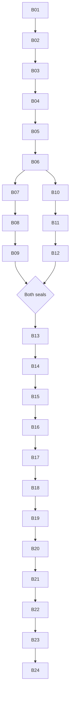

# Teyvat long-horizon tasks: first design

Status: proposed task designs, not implemented environments. These two tasks use
the existing Teyvat setting, traversal, party, and quest system. New locations and
mechanics below are authored proposals. The milestone counts are exactly 12 and
24; a milestone is a meaningful, verifiable change in quest state, potentially
requiring many navigation, combat, and interaction actions.

The intended distinction is memory complexity as well as length. The shorter
task asks an agent to retain clues through one expedition and return journey.
The longer task adds interleaved regional objectives, combining information from
different sources, and revising an earlier plan when information changes.

## Shared design choices

- Use original characters and locations in the Genshin-inspired world. Start
  with the existing Kestrel, Maren, and Wren party so all required elemental
  abilities are available without a recruitment system.
- Give a clear overall objective and local interaction feedback. The current
  goal should say what needs doing without repeating a remembered answer or
  pointing at a location the agent is supposed to recall.
- Deliver clues through readable NPC dialogue and inspectable objects. Clues
  remain available at their sources, so forgetting costs a return trip rather
  than making the episode impossible. Agent-written notes are allowed in the
  memory-enabled evaluation condition; an automatic transcript is a separate
  baseline, not a hidden advantage.
- Seed the clue contents, pillar permutations, landmark associations, and
  rendezvous choice. Every required fact must be discoverable within the
  episode. Do not require knowledge of the real game.
- Distinctive landmarks must be rendered and named consistently. Navigation
  should test recall of visible places, not guessing invisible coordinates.
- Wrong puzzle attempts reset the local mechanism and remain recoverable.
  Quest items survive defeat. Missing a time window permits another attempt
  on the next cycle. No required item can be irreversibly lost.
- Judge success from world and quest state. Talking to an NPC counts as
  receiving a clue, not evidence that the agent remembered or understood it.

## Task A: The Silent Beacon — 12 milestones

**Player-facing goal:** "Restore Windrest's beacon and bring Elder Mei proof
that the valley's signal is working again."

An old beacon needs a lens from the coast, a frame from the ruins, and an
attunement token. The agent learns the final ritual early, travels away from
Windrest, and must reuse several earlier clues on the return journey.

The proposed sites are Windrest, an inland watch camp, a sheltered cove, the old
ruins, and the summit beacon. Milestones A01–A12 form an ordered chain for the
first version. Each row describes a completion predicate, not a single action.

| ID | Milestone | Observable evidence required for completion |
| --- | --- | --- |
| A01 | Accept Mei's beacon commission. | Speak to Mei; receive the beacon's landmark description and a seeded ritual time window. Record the actual dialogue exposure. |
| A02 | Gather three windwheel asters. | Hold three asters collected from the surrounding meadows. |
| A03 | Exchange the asters for an attunement token. | Deliver three asters to Mei; consume them and grant one persistent token. Mei explains that the token will be needed for assembly. |
| A04 | Consult Scholar Arel about the ruined frame. | Receive a seeded four-pillar order. The order appears in this conversation, not in the later puzzle objective. |
| A05 | Find the coast scout and learn the lens's location. | Speak to the scout at the inland watch camp; receive a distinguishing cove landmark and learn which sentry carries its chest key. |
| A06 | Recover the key from the watch-camp sentry. | Defeat the specified shielded sentry and acquire the tide key. Party swaps and elemental reactions provide an efficient combat solution. |
| A07 | Retrieve the submerged beacon lens. | Navigate to the cove from A05, dive, and open the keyed chest; consume the key and acquire the lens. Nearby coves offer plausible alternatives. |
| A08 | Secure the old ruin courtyard. | Defeat its guards; this releases the pillar mechanism. The lens and token must remain available during the detour. |
| A09 | Solve the four-pillar mechanism. | Enter the order learned at A04; the unlocked reliquary grants the beacon frame. Wrong attempts reset the entire sequence. |
| A10 | Return to Arel and assemble the beacon heart. | At Arel, exchange the lens, frame, and attunement token together for one beacon heart. All three items must be present. |
| A11 | Restore the summit beacon at the correct time. | Find the site described at A01 and install the heart during its ritual window; verify beacon activation and grant a signal seal. Location, time, and offering must coincide. |
| A12 | Report the restored signal to Mei. | Deliver the signal seal to Mei while the beacon remains active; mark the commission complete. |

**Why the horizon matters:** A04's order is used at A09 after travel, combat,
and underwater exploration. A01's site and ritual time are needed at A11.
A03's token has a purpose delayed until A10. Returning to Arel and Mei also
tests recognition of previously visited locations.

The goal text at A09 is "Recover the frame from the ruin mechanism," not the
pillar order. At A11 it is "Restore the summit beacon using Mei's ritual,"
without the answer or an oracle direction arrow. Current inventory can list
the token, lens, and frame; remembering their existence alone is not scored as
a hidden-memory challenge.

**Suggested session variant:** pause after A06, preserving the world and the
agent's permitted saved memory. Resuming must not replay A01–A05 automatically.
The uninterrupted version comes first, pending full state serialization.

## Task B: The Three Seals of the Tempest — 24 milestones

**Player-facing goal:** "Recover the gale, tide, and ember seals, reopen the
route to the summit, and restore the storm beacon before the valley loses its
protective ward."

This is an independent campaign with its own seeded clues. The threat is
narrative motivation; the first version has no irreversible countdown.
The agent explores several regions, combines an early symbol mapping with a
later ritual order, and must update a courier rendezvous learned much earlier.

The table gives a canonical route, not a mandatory total ordering. After B06,
the gale branch B07–B09 and tide branch B10–B12 can be completed in either order
or interleaved. Both seals unlock the ember expedition. Every numbered
milestone remains mandatory.

| ID | Milestone | Observable evidence required for completion |
| --- | --- | --- |
| B01 | Accept the storm-beacon commission. | Receive the overall mission, final beacon landmark and ritual time, and the courier's initial rendezvous at the old observatory. |
| B02 | Learn the archive's symbol language. | Archivist Arel shows a seeded mapping between three glyphs and gale, tide, and ember. Record the mapping's exposure; do not repeat it at the final mechanism. |
| B03 | Locate the courier's coastal reserve cache. | Visit the courier and inspect the cache beside a distinctive coastal landmark. Learn that its transport case becomes accessible after the mountain relay is restored. |
| B04 | Learn the gale trial and the mountain route. | A ridge scout provides a seeded pillar order and identifies a traversable ascent with a recognizable ledge used later in the ember expedition. |
| B05 | Clear the lower-pass sentries. | Defeat the sentries blocking the mountain waystation. |
| B06 | Restore the mountain waystation. | Activate its relay and inspect its empty heart socket. This unlocks both first regional trials and establishes a place to revisit much later. |
| B07 | Open the gale shrine. | Use B04's remembered pillar order to open the shrine gate. |
| B08 | Defeat the gale shrine's guardian. | Defeat the guardian behind the opened gate. |
| B09 | Claim the gale seal. | Open the guardian's unlocked reliquary and acquire the unique gale seal. |
| B10 | Consult the tide warden. | Receive a seeded tide-pillar order and a landmark clue for a separate submerged salt-lens chest. |
| B11 | Recover the salt lens. | Dive at the site described at B10 and retrieve the lens. This chest is distinct from B03's reserve cache. |
| B12 | Complete the tide trial and claim its seal. | Fit the salt lens, enter B10's pillar order, and acquire the tide seal. Consume the lens only on successful installation. |
| B13 | Learn the ember rite and the final ritual order. | Once both first seals are held, the ember keeper teaches a short elemental rite and a seeded order of the three seal types for the final alignment. This order must later be translated using B02's glyph mapping. |
| B14 | Recover the ember catalyst from the high terrace. | Reuse B04's route and ledge to reach a terrace chest by climbing and gliding; acquire the catalyst. |
| B15 | Defeat the ember-forge guardian. | Defeat the shielded guardian and unlock the forge; the party's tide ability is useful here. |
| B16 | Complete the ember rite and claim its seal. | Use the catalyst and the elemental rite from B13 at the forge; consume the catalyst and grant the unique ember seal. |
| B17 | Receive the courier's relocation dispatch. | Read a dated, signed message at the forge exit: damage has made the observatory unsafe, so the courier now waits at a seeded alternative landmark. The courier's location and the observatory's notice change visibly. |
| B18 | Assemble the storm heart at the archive. | Return to Arel with all three seals; consume them together and receive the storm heart. Completion also requires B17's dispatch to have been encountered. |
| B19 | Install the storm heart at the old waystation. | Revisit B06's socket and install the heart. This restores the upper relay, opens the summit approach, and releases the reserve cache's lock. |
| B20 | Retrieve the courier's transport case. | Return to the cache seen at B03, now unlocked by B19, and acquire the transport case. No new location marker supplies the answer. |
| B21 | Meet the courier at the revised rendezvous. | Use B17's update to find the courier; exchange the transport case for a charged wardstone. Visiting the old observatory is recoverable through its forwarding notice. |
| B22 | Align the summit's three glyph pylons. | Bring the wardstone and activate the glyphs in the seal-type order from B13 translated through B02's mapping. The complete correct sequence consumes the wardstone and exposes the Stormcaller. |
| B23 | Defeat the Stormcaller. | Defeat the now-vulnerable boss and acquire its storm core. |
| B24 | Restore the valley's storm beacon. | Install the core at B01's specified beacon during its ritual window. Verify that the waystation relay and storm beacon are active and the Stormcaller is defeated. |

### Dependencies

For clarity, the final portion is one chain from B13 through B24. B18 requires
the three unique seals and the dispatch, not just a numerical progress count.
All gates are enforced in the world as well as in the quest graph: a locked
reliquary cannot be looted early, and the boss cannot be defeated before B22.

For the initial ember rite, B13 teaches: apply tide to the cooling basin,
ember to the furnace, then gale to the bellows. B16 validates those three
element-target applications in order. Wrong applications reset the rite but
retain the catalyst; consume it only when the full rite succeeds. This is an
authored recipe using the starting party, not an assumed real-game mechanic.

### Delayed information use

| Earlier evidence | Later use | Memory behavior being tested |
| --- | --- | --- |
| B01: final site and ritual time | B24: beacon restoration | Retain an instruction across almost the entire campaign. |
| B02: glyph-to-element mapping | B22: final pylon sequence | Combine old semantic knowledge with a different source's later instruction. |
| B03: reserve-cache landmark | B20: transport-case retrieval | Revisit a place whose importance was deferred. |
| B04: ascent route and ledge | B14: catalyst expedition | Reuse a previously described route after unrelated trials. |
| B06: waystation and empty socket | B19: heart installation | Recognize a previously visited mechanism and its newly available use. |
| B13: seal-type order | B22: final pylon sequence | Keep two different representations separate until they can be combined. |
| B01: old rendezvous; B17: replacement | B21: courier meeting | Prefer current evidence to a once-correct memory. |

Pillar orders in the gale and tide trials are independently seeded. Their
similarity supplies interference, while source names and distinct shrine
appearances provide enough context to disambiguate them. An example final
combination is a glyph mapping learned at B02 plus "tide, gale, ember" at B13;
the final mechanism shows glyphs, not the answer in element names.

**Suggested session variant:** checkpoint after B06, after both B09 and B12,
and after B18. These boundaries preserve completed world actions while leaving
earlier information necessary in the next session. Session boundaries do not
count as milestones.

## Horizon and evaluation

Pilot targets are 30–60 simulated minutes for Task A and 90–180 for Task B.
These are design targets, not measurements or claims about model runtime. At
the shared interface's 0.2-second decision interval, they correspond to roughly
9,000–18,000 and 27,000–54,000 decisions. Calibrate map scale and limits using
successful reference rollouts before treating these bands as task settings.
Do not achieve them by adding empty walking or prolonged mandatory waiting.

Report actual decisions, simulated time, route length, and clue-to-use delays.
Milestone count alone does not demonstrate a long horizon. For branchable tasks,
measure delays from observed encounter/use events rather than subtracting IDs.

| Measure | Definition |
| --- | --- |
| Full success | All 12 or 24 required milestones completed and the final world-state predicate satisfied before truncation. |
| Partial progress | Unique completed required milestones divided by 12 or 24. Raw objective counts may differ because a milestone can have several predicates. |
| First-attempt recall | Correct initial puzzle sequence, first visited candidate site, or initial ritual attempt after each designated delay. Record each probe separately. |
| Recovery cost | Decisions, extra travel, wrong sequences, and clue-source revisits needed after a mistake. Revisits remain legal. |
| Information update | Whether B21's first attempted rendezvous follows B17; separately record whether the new dispatch was actually exposed. |
| Efficiency | Decisions and path length relative to a verified successful reference on the same seed; report alongside success, not instead of it. |
| Resume retention | Success and recall after session boundaries compared with uninterrupted runs on the same task seeds and memory policy. |

Use a sparse reward of one unit per milestone plus a final completion bonus;
report normalized milestone progress separately for comparison across lengths.
Disable target-distance shaping in the memory evaluation: otherwise reward
changes themselves can disclose an undiscovered goal's direction. Avoid credit
for the same milestone more than once, including after defeat or resume.

Compare the same agent/controller under bounded recent context, persistent
agent-written notes, and a complete-history reference condition. A further
answer-visible condition can help distinguish memory failures from navigation
or combat failures. Log context budgets and allowed external storage explicitly.
Hold out both terrain seeds and clue assignments, with assignments sampled
independently of place names and entity IDs. Always give a new memory store to
an independent task instance.

## Implementation fit and required additions

The existing system supplies useful primitives, but neither table can simply
be pasted into the current quest library and assumed runnable.

| Area | Current implementation | Work required for these tasks |
| --- | --- | --- |
| Quest structure | `Quest`, `Stage`, and prerequisite graphs in `open_world_bench/quests/schema.py`; basic predicates in `engine.py`. | Add task selection, stable milestone IDs, and milestone-level success metrics. Encode Task A as a chain and Task B with the explicit regional fork/join. |
| Content and placement | `library.py` places the existing Windborne Ledger questline using terrain sampling. | Author both task layouts and seeded clue manifests together. Validate routes, dive sites, landmark visibility, and all interactions for every admitted seed. |
| Dialogue delivery | NPC interaction emits a `talk` event with text; NPC dialogue is static. | Add stage-aware dialogue/inspectable clue objects and make newly encountered text available in the declared agent observation. Log which facts were actually exposed. |
| Observation boundary | Native `task` observations contain goal direction and distance. The shared interface hides the goal vector by default, but still exposes current instructions. Existing ruin instructions contain the answer. | Separate public goal text and known inventory from private predicates, target IDs, and clue answers. Audit rewards, hints, events, HUD, and all policy-visible `info` fields. Provide current local dialogue without automatically replaying remote history. |
| Item use | `DELIVER` checks one item type and consumes it when talking to a target NPC; quests can grant items. | Add atomic multi-item exchanges, keyed chests, and offerings that check items, site, time, and prerequisites in the same interaction. Failed attempts must not consume items. |
| World gates | Quest prerequisites control progression; world interactions are not generally locked by them. | Gate chests, shrine mechanisms, and boss vulnerability. Use persistent facts or a deduplicated event history so valid early exploration cannot strand an event-based objective. |
| Puzzle recovery | The quest engine can clear an incorrect sequence, but interacting with a pillar currently marks it used. | Make puzzle pillars reusable and reset their visible state with sequence progress. Score only a complete sequence; handle extra inputs and retries deterministically. |
| Elemental trials | Party swaps, elemental attacks, reactions, and shields already exist. | Add forge/pylon elemental receivers for B16 and distinguish skill application to puzzle objects from generic interaction. Define a rite achievable with the starting party. |
| Time conditions | `ALTITUDE` supports a location/time constraint; `ACTIVATE` does not enforce that same time condition. | Validate timed offerings atomically. A prior dawn visit must not authorize an offering made later at night. Specify ritual windows using the simulator's time scale and matching visible sky/clock cues. |
| Changed information | NPCs have a position and a static dialogue string. | Script the B17 move, update the old observatory's notice, and keep both dispatch and forwarding notice readable. No dynamic terrain collapse is required for this version. |
| Persistence | Quest snapshots summarize progress, but do not provide a complete world/quest restore path. | Before session variants, save and restore entity state, inventory, party, time, quest counters, puzzle state, clue assignments, RNG state, and agent-owned memory separately. |

For each milestone, implementation should record `id`, prerequisites, public
goal, private completion predicate, facts exposed, facts needed later, item
inputs/outputs, recovery behavior, and reward. Facts need source IDs and exposure
timestamps; changed facts additionally need versions or a supersedes relation.
Keep the full authored tables and seed manifests in evaluator data, not in the
agent's task prompt.

Build and validate Task A first, then reuse its item exchanges, recoverable
puzzles, and observation contract for Task B. Before calling either a benchmark,
verify a complete legal rollout, failed-attempt recovery, no repeated rewards,
no missing items after defeat, reachable seed layouts, and no answer leakage.
Then add the scripted relocation and, finally, the resume evaluation variant.
