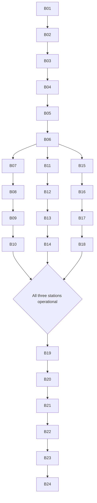

# Wildlands long-horizon tasks: first design

Status: proposed designs, not runnable task implementations. These tasks target
`wildlands`, the repository's original environment inspired by The Legend of
Zelda: Breath of the Wild. All locations, characters, and mechanisms below are
new authored content. The milestone counts are exactly **12** and **24**.

A milestone is a verifiable accomplishment that can require many actions. It
is not one button press or one waypoint. The shorter task tests preparation,
delayed recall, and reuse of a physical principle during a mountain expedition.
The longer task adds interleaved objectives, information from multiple sources,
and a previously valid route that changes. Neither requires real-game knowledge.

## Shared design choices

- Emphasize climbing, gliding, cooking, temperature, weather, gravity, and
  manipulating existing objects. Use fixed mechanisms and movable weights;
  vehicle construction belongs to the separate Skylands setting.
- Start with a glider and a proposed magnetic grip for moving nearby metal
  bodies. Teach its controls in a safe area. It cannot target distant or hidden
  objects. Rune items exist in the codebase, but a playable grip is new work.
- Give the overall objective, readable local clues, and visible mechanism
  feedback. Current objectives must not repeat remote clue answers, reveal
  unknown coordinates, or automatically navigate to remembered places.
- Keep sources readable on return. Forgetting should cost a revisit; it should
  not permanently erase the only solution. Agent-written notes are allowed in
  the memory condition. An automatic full journal is a separate baseline.
- Seed landmark associations, calibration marks, channel mappings, and route
  changes. Keep physical laws consistent. Required facts must be discoverable
  during the episode; randomization must preserve a solvable layout.
- Accept any physically valid solution to a mechanism's completion predicate.
  For example, sufficient supported mass can open a pressure gate regardless
  of which eligible weights supplied it. Record the solution used.
- Separate consumable food, equipment durability, unique repair parts, and
  installed infrastructure. Quest parts cannot be eaten, burned, or destroyed.
  Installation transfers their identity into the mechanism; it does not spawn
  a replacement copy. Failed installations consume nothing.
- Wrong settings and displaced puzzle bodies are recoverable. Provide a local
  reset for essential bodies and a reachable return route from failed jumps.
  Task-authored resupply points prevent exhausted food from causing a softlock.
  Resupply costs travel and is logged; it is not unlimited instant healing.
- In the first version, death ends the attempt, matching current Wildlands.
  Recoverable mistakes are not a promise of automatic revival. Checkpoint and
  resume variants require additional persistence work.

## Task A: The Frostbound Pass — 12 milestones

**Player-facing goal:** "Repair the mountain intake, drain the flooded pass,
and return to Reedbank with the road open."

Reedbank's mountain road is underwater because its intake regulator has failed.
The agent prepares for two cold stretches, retrieves a replacement from a
shrine, finds a tool cache described much earlier, and repairs the intake.
The final mechanism reuses a physical principle learned in the shrine and a
calibration mark recorded at a distant survey tower.

The route connects Reedbank, a survey tower, a mountain shrine, a ranger cache,
a ridge refuge, and the upper intake. The table gives the intended first route;
exploration and resupply detours remain legal.

| ID | Milestone | Completion predicate and relevant evidence |
| --- | --- | --- |
| A01 | Take the pass-repair commission. | Inspect the work order at Reedbank. It identifies the intake, describes the seeded landmark beside the ranger cache, and warns of two separate cold stretches. Record actual clue exposure. |
| A02 | Prepare the expedition's provisions. | Gather ingredients and cook two qualifying cold-resistance servings at a pot. Their potency and duration must meet the task layout's published exposure requirement; the work order explains the ingredient rule. |
| A03 | Survey the valley from the tower. | Reach the tower deck and inspect its gauge chart. Learn the seeded safe intake mark and identify the service exit overlooking the flooded road. The chart remains here for later consultation. |
| A04 | Open the counterweight shrine. | Move supported mass onto the gate's load plate, hold it above the visible threshold for two simulated seconds, and enter the opened vestibule. The gate latches; the tablet explains the same load principle used at the intake. |
| A05 | Retrieve the replacement regulator. | Light the shrine's sheltered brazier and use its updraft, or another valid route, to reach the upper chamber. Acquire the unique regulator and the ranger-cache key. The chamber lies beyond A04's gate. |
| A06 | Recover the service handle. | Find the cache described at A01 and open it with A05's key. Acquire the handle needed to mount and turn the intake regulator. No new marker supplies the cache location. |
| A07 | Establish the ridge refuge. | Reach the refuge, light its sheltered campfire, and inspect the route board. The refuge provides a pot and replenishable ingredients; the board distinguishes the exposed climb from a sheltered ascent usable in rain. |
| A08 | Reach the upper intake alive. | Traverse the second cold stretch and enter the intake service platform with health above zero. Route choice, meal timing, stamina stops, and any resupply are recorded; a specific path is not mandatory. |
| A09 | Release the intake's maintenance brake. | Load its differently arranged counterweight cradle above the marked threshold for two simulated seconds. This applies A04's principle to a new arrangement and latches the service housing open. |
| A10 | Install the regulator and service handle. | With A09's housing open, mount both unique parts in their matching sockets. Transfer both from inventory atomically; the assembled regulator becomes operable. |
| A11 | Calibrate the intake and drain the pass. | Select the safe gauge mark learned at A03, then engage the regulator. Hold a valid flow state for five simulated seconds; verify the pass water has fallen below the road surface. Wrong marks trigger a reversible local shutdown. |
| A12 | Return through the reopened pass and report. | Traverse the drained road between its two boundary markers and register completion at Reedbank while the intake remains calibrated and the road remains open. |

**Dependencies:** A01 → A02 → A03 → A04 → A05 → A06 → A07 → A08 → A09 →
A10 → A11 → A12 is the canonical route, not a requirement to suppress early
exploration. The physical gates are the shrine entrance, keyed cache, intake
housing, two-part installation, and actual drainage. Store persistent facts for
earlier valid actions, such as lighting the refuge before acquiring the handle.
All 12 accomplishments remain required for full benchmark success.

**The memory test:** A01's cache landmark is needed at A06; A03's safe mark is
needed at A11; A04's counterweight principle is applied at A09. A02 prepares for
two separated uses of food. Current inventory and effect timers stay visible,
so remembering an invisible inventory is not the claimed challenge. Using both
servings early is recoverable by returning to a pot and restocking.

For example, one seed teaches "the amber notch is safe" at the tower, while
the intake later displays amber, blue, and white notches. A different seed
changes the safe notch. The objective says "Calibrate the repaired intake,"
not which notch to choose. Wrong attempts expose local failure feedback but
no graded distance to the answer.

The first cold section covers the shrine approach; the second covers A08–A11.
Size and temperature must make each section feasible with the stated meal
budget plus a safety margin. Sheltered interiors and the ridge refuge break
exposure. Permit additional meals and alternate safe solutions, and measure
their cost rather than failing an otherwise successful repair.

**Suggested session split:** pause after A06. The next session still needs
A03's calibration and A04's physical principle. Do not replay those clues on
resume. This variant is deferred until full state restoration exists.

## Task B: The Valley Before the Storm — 24 milestones

**Player-facing goal:** "Restore the valley floodworks, divert the rising
water away from the designated refuge, and reopen its evacuation road."

Three regional systems drive the floodworks: a ridge wind actuator, a marsh
pump, and a quarry heat engine. Each restores persistent infrastructure;
there is no requirement to collect three interchangeable shrine tokens.
The agent may complete the regions in any order. Once all three are restored,
a storm changes a known route, and the final repair requires revisiting an
early cache and combining an early overflow authorization with a later channel
survey.

The storm is a deterministic task event, with visible weather and bridge-state
changes. It is not an irreversible deadline in the first version. Regional
systems latch into a weatherproof operational state once commissioned, so
finishing one branch does not impose an unseen timer on another.

| ID | Milestone | Completion predicate and relevant evidence |
| --- | --- | --- |
| B01 | Accept the floodworks commission. | Inspect the valley work order. Learn which seeded refuge must be protected, its identifying landmark, and which named basin is currently cleared to receive floodwater. Start with the standard glider and magnetic grip. |
| B02 | Prepare separate cold and heat provisions. | Cook qualifying cold-resistance and heat-resistance supplies in separate dishes. The work order teaches the ingredient families and required exposure budgets. Mixing incompatible families is a recoverable resource mistake. |
| B03 | Survey the causeway and reserve cache. | Reach the causeway tower and inspect the reserve-winching depot below it. Record its landmark and the normal bridge approach. The depot's powered shutter is visibly inactive until all three regional systems run. |
| B04 | Recover the maintenance kit. | Retrieve the unique kit from a raider-held supply yard. Combat or a valid stealth route may succeed. The kit contains a coupling for each regional system and a reusable service tool. |
| B05 | Restore the central maintenance lift. | Use the magnetic grip to load the lift's counterweight cradle and raise its platform into a stable service position. Reach the central control gallery. This teaches mass and support before later transfer problems. |
| B06 | Open the regional service routes. | At the gallery, inspect the commissioning diagram and release the three service gates. Learn the safety rule: open the selected overflow route before enabling inflow. The diagram lists the three regional stations and their roles. |
| B07 | Establish the ridge refuge. | Reach the cold-region refuge and light its sheltered fire. Inspect its ascent board and make its pot and replenishable ingredients accessible. |
| B08 | Reach the wind observatory. | Complete the cold ascent and inspect the observatory's seeded wind-vane alignment mark. Note the recognizable sheltered ledge available for return travel. |
| B09 | Free the wind actuator. | Move its metal counterweight off a jammed carriage and onto a supported cradle. Verify free carriage travel rather than a memorized list of grip actions. |
| B10 | Commission the wind station. | Install the wind coupling from B04 and set the vane to B08's mark. The actuator must deliver stable output for five simulated seconds; it then latches operational. |
| B11 | Open the marsh pump house. | Traverse the wetland approach and use the service tool at the maintenance hatch. Reach its dry interior and access the pump controls. Swimming, gliding, and any viable bank route are accepted. |
| B12 | Power the marsh pump circuit. | Position a conductive slab across two marked, insulated contacts. The dry service platform and warning signs teach safe handling. Verify a closed circuit; this is a bounded authored circuit, not assumed arbitrary electrical simulation. |
| B13 | Survey the downstream channels. | Reach and inspect the downstream gauge station. Learn the seeded mapping between three valve symbols and three named receiving basins. This geographical chart does not state which basin is currently cleared for flooding; that authorization was given at B01. |
| B14 | Commission the marsh station. | Install B04's pump coupling and prime the powered pump. Verify stable output for five simulated seconds, then latch the station operational. The task requires B13's survey to be inspected as part of commissioning. |
| B15 | Establish the quarry cooling stop. | Reach the shaded quarry camp and inspect the heat-route board. Its pot and replenishable cooling ingredients become available; the board identifies a sheltered furnace approach. |
| B16 | Reach the furnace service deck. | Manage heat exposure, light a sheltered furnace brazier, and use its updraft or another valid route to reach the deck. This opens access to the engine governor. |
| B17 | Balance the quarry governor. | Arrange available metal weights on supported pans to bring the visible balance indicator into its safe band for two simulated seconds. Apply B05's mass/support principle in a different layout. |
| B18 | Commission the heat engine. | Install B04's heat coupling and engage the balanced governor. Verify stable output for five simulated seconds, then latch it operational. Completion of all three regional stations powers the reserve depot and triggers the storm transition. |
| B19 | Return to the hub and inspect the storm damage. | After B10, B14, and B18, reach the gallery and read its dated damage report. The normal bridge to B03's depot is now impassable; a seeded alternate approach is described by visible landmarks. The final lock's missing winch is diagnosed. |
| B20 | Retrieve the reserve winch. | Revisit B03's depot, using B19's revised approach or another safe route, and retrieve its unique winch through the now-powered shutter. An attempted old-bridge route is logged and recoverable. |
| B21 | Repair the final floodgate. | Return to the central lock and install the reserve winch with B04's service tool. Verify that the gate can move through its service range. The winch transfers into the lock; the tool remains reusable. |
| B22 | Configure safe water routing. | Combine B01's overflow authorization with B13's symbol-to-destination map. Open the approved basin's branch and close the other two. The panel shows symbols and local flow status, not destination names or flood authorization. |
| B23 | Commission the connected floodworks. | Following B06's rule, open the configured overflow before enabling inflow. All three regional outputs, the repaired winch, and safe routing must hold together for five simulated seconds. Verify safe refuge levels and a drained evacuation road. |
| B24 | Reopen the refuge's evacuation route. | Traverse the drained road to B01's designated refuge and activate its completion signal while the commissioned floodworks remain safe. This is a route-verification mission, without an NPC escort system. |

### Dependencies and physical behavior

This is the milestone dependency graph, not an instruction to number the
agent's actions. The three regional chains can be interleaved after B06.
Use persistent state and exposure records to credit valid earlier actions when
their prerequisites become satisfied. Physical gates enforce item and access
dependencies; the milestone counter itself must not serve as a universal key.

The storm triggers once at the join, whichever region finishes last. It changes
the causeway bridge's collision and appearance, creates the gallery report,
and places a matching notice before the old bridge's safe stopping point.
Other crossings stay viable. Rain and lightning must leave the alternate route
feasible; no required jump depends on a lucky weather transition. Direct
gliding or another safe shortcut is legal and should not be scored as failure
to obey the suggested route.

Water behavior can start as an authored, discrete network: station outputs,
valve states, and a few bounded water volumes with matching collision and
rendering updates. A general fluid solver is not required. Unsafe commissioning
trips an interlock, closes inflow, and resets local pressure without destroying
refuges or repair parts. It gives categorical failure feedback, allowing
recovery while preserving a meaningful first-attempt score.

Keep the commission and channel map separately meaningful: B01 identifies the
refuge needing the final signal and the basin currently authorized for flooding;
B13 maps named basins to valve symbols. The assignment guarantees that the
approved basin is unoccupied and separate from the refuge's basin. The third
basin is not authorized for flooding. Neither clue alone identifies the correct
valve. Sample the authorization and symbol mapping independently subject to
those safety constraints.

### Delayed information use

| Earlier evidence | Later use | What it tests |
| --- | --- | --- |
| B01: refuge landmark and authorized overflow basin | B22 and B24: route water safely and reach the refuge | Retention across the entire campaign and return navigation. |
| B02: ingredient families and supplies | B08 and B16: separated cold/heat exposures | Resource allocation and choosing the right procedure in context. |
| B03: depot location and old approach | B20: reserve-winch retrieval | Remembering a place before its contents become useful. |
| B05: supported mass moves mechanisms | B09 and B17: actuator/governor repair | Transfer of a physical principle rather than a fixed action script. |
| B06: overflow-before-inflow rule | B23: network commissioning | Retain a procedural safety constraint through three branches. |
| B08: wind-vane mark | B10, possibly after other branches | Source-specific recall; report the actual delay for the chosen route. |
| B13: channel symbols and destinations | B22: final routing | Combine remote spatial/semantic information with the mission. |
| B03: bridge approach; B19: storm update | B20: changed route | Replace stale information using newer, explicitly exposed evidence. |

**Suggested session splits:** after B06, after two complete regional branches,
and after B19. A split is not a milestone. Branch-dependent boundaries must be
recorded explicitly so resume comparisons use the same world history.

## Horizon and evaluation

Initial pilot targets are **30–60 simulated minutes for Task A** and
**90–180 for Task B**. These are unmeasured design targets. At the default
0.2-second decision interval, they imply approximately 9,000–18,000 and
27,000–54,000 decisions. Current small worlds and episode limits should not be
assumed sufficient. Calibrate layouts and budgets with successful reference
rollouts; do not inflate the horizon with empty walking or mandatory waiting.

Measure actual decisions, simulated time, distance, and each clue's exposure-to-use
delay. Milestone counts alone do not establish long-horizon difficulty. The
24-milestone task differs in branching and changing conditions as well as length;
a strict experiment on length alone needs matched shorter/longer variants later.

| Measure | Definition |
| --- | --- |
| Full success | All 12 or 24 unique milestones and the final live world-state predicate satisfied before death or truncation. |
| Partial progress | Number of unique completed milestones divided by 12 or 24. Report which branches were completed. |
| First-attempt recall | Correct initial calibration, cache destination, routing configuration, or commissioning procedure after its designated delay. Log each probe separately and whether its clue was exposed. |
| Recovery cost | Extra travel, failed settings, local resets, resupply, and clue-source revisits after an error. |
| Resource management | Exposure damage, food used by effect family, resupply trips, and weapon breakage when combat is attempted. |
| Updating stale information | First attempted depot approach after B19; distinguish using the update, choosing another safe route, and retrying the closed bridge. |
| Efficiency | Decisions and distance against a verified successful rollout on the same seed, reported alongside success. |
| Resume retention | Change in success and recall after session boundaries under a declared memory policy. |

Use one-time milestone rewards and a completion bonus; normalize progress by
task length for comparisons. Disable discovery shaping and hidden-target
distance rewards in the memory evaluation. Repeated resets or revisits must not
produce repeated milestone credit. Wrong settings must not generate a graded
reward signal that serves as an answer oracle.

Compare bounded recent context, persistent agent-written notes, complete
history, and an answer-visible reference. Keep the controller, observations,
action budget, and random seeds matched. The answer-visible reference helps
separate memory failures from difficult traversal or manipulation. Declare
storage/context budgets and start each independent instance with fresh memory.

Hold out terrain/layout seeds and clue assignments independently. Inspect all
policy-visible observations, HUD text, event payloads, IDs, and `info` fields:
private predicates and undiscovered locations must remain evaluator-only.
Local interaction text should be available to text-capable policies and shown
through a readable in-world interface for visual-only policies. Report those
modalities separately.

## Fit to the current implementation

The existing [Wildlands guide](wildlands.md) describes an exploration sandbox.
Its `reward_mode="milestone"` currently means first landmark visits, not the
quest milestones above. The environment has no task victory condition yet.

| Area | Available foundation | Required addition |
| --- | --- | --- |
| Traversal and survival | Walking, climbing with rain penalties, gliding, swimming, stamina, temperature, food effects, melee, and weapon wear. | Author and validate exposure budgets, safe rest points, routes, and deterministic resupply for every admitted layout. |
| Fire and lift | `owb/physics/elements.py` supplies campfire warmth and updrafts. | Author safe braziers and feasible chamber geometry. Do not assume decorative furnaces already provide these interactions. |
| Movable bodies | `owb/physics/bodies.py` defines bodies with mass, buoyancy, and magnetic/conductive tags. | Expose magnetic-grip controls; add supported-load sensors, stable mechanism states, local resets, and deterministic puzzle feedback. Tags alone are not playable puzzles. |
| Stations and parts | Inventory, cooking, reachable chests, and proposed environment extension points exist. | Add typed repair parts, atomic installation, tool use, quest-aware chest locks, circuits, vane controls, and winch/valve mechanisms. |
| Clues and presentation | Landmarks, local text, and the visited-cell minimap exist. | Add inspectable work orders, diagrams, route boards, versioned reports, and actual exposure logging. No NPC dialogue engine is required for the first version. |
| Task state | `WildlandsEnv._task_outcome()` is an extension hook; `WildlandsAdapter.metrics()` currently reports undefined success/progress. | Implement milestone state and prerequisites, full success, one-time rewards, termination, and shared-interface metrics. |
| World changes | Voxel terrain and weather can update. | Author bounded drainage, gate motion, the bridge closure, and observation-consistent network state. These mission mechanics do not exist yet. |
| Failure and persistence | Death terminates; reset reproduces a seed. | Keep that contract for the first release. Before resume variants, serialize world edits, entities, bodies, installed parts, food timers, weather/RNG, clue versions, milestone rewards, and agent memory separately. |

Each milestone specification should include its stable ID, prerequisites, public
goal, private predicate, facts exposed/used, item transfers, recovery behavior,
and reward. Facts need source IDs and exposure timestamps; changed route facts
need a version or supersedes relation. A final success check must inspect the
current repaired world, not just a historical completion bitmask.

Implement Task A first: clue inspection and task state, magnetic manipulation
and load sensors, unique-part installation, then bounded drainage. Validate a
complete legal rollout and failures before adding Task B's three-region graph,
network commissioning, route change, and eventual resume support. Required
checks include solvable seeds, correct meal budgets, reset recovery, no lost
parts or duplicate rewards, synchronized visuals/collision, and no answer leaks.
