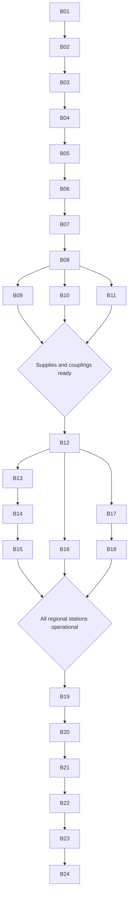

# Wildlands long-horizon memory and skill-learning tasks

Status: full benchmark designs, with separate [compact executable reference
courses and demonstration recordings](wildlands-reference-demos.md). The compact
courses do not yet implement the full long-horizon memory evaluation. These two tasks
use the original Breath of the Wild-inspired `wildlands` setting and retain
exactly **12** and **24** milestones. The revision makes learning from experience,
delayed retrieval, and reusable skills the central experimental structure.

## What these tasks should establish

The core sequence is **experience → unassisted practice → intervening work →
retrieval → transfer → composition**. A long journey or a remembered password
alone does not demonstrate skill learning.

Here, learning from memory means that a fixed-weight agent stores experiences,
extracts useful procedures, and later retrieves and adapts them. Weight updates
are a separate experimental condition. A reusable skill includes when to use it,
what objects and parameters it needs, how to check progress, and when to stop or
recover. Replaying a sequence of coordinates is not sufficient.

Separate five questions:

1. **Acquisition:** could the agent solve an unprompted practice variant soon
   after experiencing the mechanism?
2. **Retention:** can it still use that skill after substantial intervening work?
3. **Transfer:** can it adapt to new objects, geometry, parameters, and conditions?
4. **Selection:** does it retrieve the right skill and avoid applying it when its
   preconditions do not hold?
5. **Composition:** can it connect learned skills to solve a new multistage problem?

Task A isolates two learned skills and delayed transfer. Task B adds a third
skill, interference, explicit applicability tests, changed information, and a
final composition. Episodic facts and spatial recall remain supporting tests.
The two tasks differ in more than length; do not interpret their score difference
as a pure effect of horizon.

## Reusable skills and how the agent learns them

These names and descriptions are evaluator specifications. Do not insert this
skill library into the agent's prompt. The agent learns from inspectable devices,
safe demonstrations, its own attempts, and visible consequences. Basic movement,
magnetic-grip controls, and how to read a gauge are taught independently so that
learning a task procedure is distinguishable from discovering the action API.
Both tasks start with a glider and the proposed magnetic grip; the grip acts
only on nearby visible eligible objects.

| Skill | General procedure and applicability | Acquisition evidence | Changed test instance |
| --- | --- | --- | --- |
| S1: support and release | For a counterweighted, latched mechanism: identify the load support and brake, hold the mechanism, establish a supported load in its safe band, then release and verify stable motion. Recover by re-engaging the brake and adjusting the load. | A workshop example exposes why releasing an unsupported or unbalanced mechanism trips its brake. The agent then repairs a different lift without step-by-step hints. | New masses, multiple valid weight combinations, a rotated layout, and different objects; the same device-family control meanings remain valid. |
| S2: establish a safe updraft | For a usable thermal shaft: inspect the outlet and shelter, clear/open the draft path, establish a protected heat source, verify lift and safe temperature, then launch toward a reachable landing. Stop or alter the setup if the plume is unsafe. | Contrasting hearths show a sheltered working draft and a blocked/exposed draft that cannot sustain lift. A separate gallery must then be reached without a demonstrated action trace. | Rain, a relocated vent, different landing geometry, and a furnace plume that is initially too hot. Igniting the nearest visible fire is not a universal solution. |
| S3: route before feeding | For an isolatable flow network: keep the inlet shut, identify an authorized outlet, isolate other branches, establish the outlet path, enable the inlet, and verify stable pressure/temperature. On a trip, isolate and reconfigure. | A safe training network visibly trips when fed against a closed outlet. The agent must commission a different network with a new requested outlet and layout. | A marsh pump, a quarry cooling bypass, and the final floodworks, with different topology and destination assignments. |

S1 and S2 occur in both tasks; S3 is introduced in Task B. Physical behavior is
consistent. Instance-specific facts, such as the authorized destination, must
remain separate from the procedure that uses them.

To make episode experience relevant beyond generic game knowledge, sample a
stable control-symbol-to-role mapping for each device family at task reset.
Training displays observable effects that disambiguate every role needed later.
Transfer fixtures retain the family mapping but change control positions,
geometry, and parameters. A visible maker's crest identifies the family without
providing the control meanings. Different families can reuse symbols with
different meanings, creating source interference without ambiguous instructions.
Never silently change a family's mapping halfway through an episode. Physical
laws, such as heavier loads having more weight, are not randomized.

Treat remembering these bindings as its own result. It is not sufficient
evidence of learning a procedure. Include a diagnostic reference that supplies
the previously exposed symbol meanings but withholds action ordering,
applicability, and recovery rules; compare it with procedural memory. This
separates an associative-memory advantage from a reusable-skill advantage.

Before admitting a seed, verify that the training evidence distinguishes the
valid procedures from plausible alternatives. No critical hidden distinction may
first appear in an unannounced scored test. Training failures are recoverable and
may be demonstrated safely by a fixture; the agent need not deliberately fail.

An optional agent-authored memory entry could contain:

- device family, trigger, and preconditions;
- parameters and bindings to local objects;
- a procedure with feedback checks and recovery conditions;
- supporting episode references and observed limitations;
- confidence or unresolved alternatives.

This is a possible representation, not a required output format or a supplied
answer. Natural-language notes, episodic retrieval, and executable routines can
be compared. Executable routines must use the same primitive actions, observation
access, simulation-step accounting, and declared compute limits as other agents;
they receive no privileged simulator calls.

## Task A: The Frostbound Pass — 12 milestones

**Player-facing goal:** "Repair the mountain intake, drain the flooded pass,
and return to Reedbank with the road open."

The agent first learns two practical skills in a low-risk workshop, then leaves
for a supply expedition. The upper intake later presents unfamiliar instances
of the same device families. Its objectives describe outcomes, without naming
which earlier skill should be recalled.

| ID | Milestone | Completion predicate and memory role |
| --- | --- | --- |
| A01 | Accept the repair commission. | Inspect the work order and receive the ranger cache's seeded landmark description. Record the exposure; this is an episodic fact, not evidence of a learned skill. |
| A02 | Restore the workshop lift. | After a safe observable example and feedback, operate the training counterweight mechanism and reach its stable upper stop. This provides S1 experience. |
| A03 | Reach the workshop's thermal gallery. | Inspect the contrasting hearths, establish a working draft, and reach the gallery. Record which conditions and outcomes the agent actually observed for S2. |
| A04 | Open the practice service gate. | Solve a fresh S1 fixture with changed masses and control positions, without procedural hints. The gate must move safely and latch open; record first-attempt performance and retries as the immediate acquisition check. |
| A05 | Recover the workshop salvage kit. | Reach a new gallery with changed hearth and landing placement, using a valid solution. An S2 solution provides the immediate acquisition check; the unique kit is needed at the coastal depot. |
| A06 | Survey the valley. | Reach the survey tower through an ordinary accessible route and inspect the intake's seeded calibration mark and the coastal depot bearings. This begins work that does not rehearse S1 or S2. |
| A07 | Obtain the replacement regulator. | Navigate to the coast and exchange A05's kit at a mechanical supply locker for the unique regulator and ranger-cache key. Gathering and cooking adequate travel provisions are supporting actions, not separate memory milestones. **Working memory (`WM-WA07`, hold, load 4):** the locker stays shut until a four-digit code is keyed in on its keypad. The locker stands at the end of the aisles of a closed stores warehouse on a loading dock, which is entered by climbing, so a horse cannot shorten the trip. The code is drawn per episode and posted only on the dispatch board at the depot entrance, which cannot be seen from the keypad. |
| A08 | Retrieve the cached service handle. | Use A01's remembered landmark and A07's key to find and open the ranger cache. Acquire the handle. No new location marker supplies the answer. |
| A09 | Open the upper intake's service housing. | Apply S1 to a new arrangement with several eligible weights, a different safe load band, and rotated controls. Verify stable opening. This is the first delayed S1 transfer probe. |
| A10 | Reach the intake control gallery. | Apply S2 in a rainy setting with an exposed decoy hearth and a usable sheltered shaft. The shaft is accessible after A09. Verify a safe arrival; this is the first delayed S2 transfer probe. |
| A11 | Restore and calibrate the intake. | Atomically install A07's regulator and A08's handle, select A06's calibration, and hold valid flow for five simulated seconds. Verify the road has drained. Wrong calibration trips a reversible interlock. |
| A12 | Reopen the pass and report. | Traverse the drained road to Reedbank and register completion while the repaired intake remains operational. |

**Structure:** acquisition A02–A03; immediate unassisted checks A04–A05;
intervening work A06–A08; delayed transfer A09–A10; episodic recall and mission
completion A11–A12. Navigation, supplies, and cache recovery make the intervening
work useful, rather than padding the task with waiting.

The canonical route follows the numbered sequence. Physical locks and item
transfers make the workshop kit, regulator, cache key, and handle necessary.
Keep persistent evidence for legitimate early exploration rather than discarding
an event because the next milestone was not active. Rehearsal or returning to a
training site remains legal, but it is logged and changes the measured retention
delay. The strict diagnostic probes below control this confound separately.

**Concrete transfer example:** the workshop lift needs one slab on its left
cradle; the later intake needs two smaller weights on a right-side cradle and a
brake located elsewhere. The transferable knowledge is how to bind brake,
support, load, and release roles, use the gauge, and recover. A recorded action
sequence such as "move left, place slab, press the upper switch" will not solve
both instances. Current load gauges stay visible; the learned family-specific
control meanings and procedure are not restated.

**Memory trace:** A01 → A08 tests landmark recall; A06 → A11 tests calibration
recall; A04 → A09 tests retained S1 competence; A05 → A10 tests retained S2
competence. Measure delays from actual last relevant exposure/rehearsal, not
milestone-number differences.

**Session variant:** pause after A08, preserving world state and only the
memory permitted by the evaluation condition. Do not replay workshop episodes
or provide hand-written skill summaries at resume. Full restoration is new work.

## Task B: The Valley Before the Storm — 24 milestones

**Player-facing goal:** "Restore the valley floodworks, divert the rising
water away from the designated refuge, and reopen its evacuation road."

The agent builds a small skill repertoire, leaves it unused during other work,
then must recognize its uses across three regions. Familiar-looking mechanisms
sometimes have incompatible conditions. The final lock requires coordinating
all three skills and facts acquired at different times, after a route changes.

| ID | Milestone | Completion predicate and memory role |
| --- | --- | --- |
| B01 | Accept the floodworks commission. | Learn the designated refuge and its landmark, and which named basin is authorized to receive floodwater. Those instance-specific facts must survive the full campaign. |
| B02 | Restore the training counterweight lift. | Observe the fixture's feedback and achieve stable lift operation. Acquire S1 experiences and the task's counterweight-family control meanings. |
| B03 | Repair a second counterweight gate. | Solve a new mass/layout variant without hints. Record immediate unassisted S1 competence; merely inspecting B02 does not count as learning. |
| B04 | Restore the training thermal shaft. | Inspect working and failed draft conditions and reach its gallery. Acquire S2 experiences and thermal-family control meanings. |
| B05 | Reach a second thermal gallery. | Solve a changed shelter/vent layout without hints. Record immediate unassisted S2 competence. |
| B06 | Restore the training flow circuit. | Observe a safe interlock demonstration and establish stable authorized flow. Acquire S3 experiences and flow-family control meanings. |
| B07 | Commission a second flow circuit. | Solve a different topology with a different locally specified outlet, without procedural hints. Record immediate unassisted S3 competence. |
| B08 | Survey the reserve depot. | Reach the causeway tower and inspect the depot's landmark and normal bridge approach. Its powered shutter will open only when all regional stations operate; remember a place that is not yet useful. |
| B09 | Establish expedition supplies. | Reach the ridge refuge, light its sheltered fire, and prepare separate cold/heat provisions. Its pot and resupply route remain available. Ordinary campfire use does not supply S2's shaft-control procedure. |
| B10 | Recover the wind coupling. | Retrieve the unique coupling from a raider-held yard by combat or a viable stealth route. This is useful intervening work that does not exercise the three learned procedures. |
| B11 | Recover the pump and engine couplings. | Navigate the coastal supply route and retrieve both unique parts using the commission's service authorization. The route requires ordinary traversal, not an S1/S2/S3 fixture. **Working memory (`WM-WB11`, select, 2 slots):** the yard manifest at the yard gate names the bay holding each coupling. The yard office releases six numbered bays in a store out of sight of the manifest; the bays look alike and carry similar part-name labels. Opening a bay is the choice, and a wrong bay is simply empty. |
| B12 | Survey the downstream channels. | Reach the archive gauge station and inspect the seeded valve-symbol-to-basin map. Also inspect a readable furnace warning identifying the plume-temperature gauge and safe launch band. It supplies new local safety information without repeating a skill procedure. |
| B13 | Open the ridge actuator housing. | Recognize the counterweight device family and apply S1 to new masses and geometry. Verify the housing is stably open. |
| B14 | Reach the wind-station service deck. | Recognize a usable thermal shaft, apply S2 under changed wind/shelter conditions, and reach the deck. It is accessible after B13. |
| B15 | Commission the wind station. | Install B10's coupling into the serviced actuator and verify stable output for five simulated seconds. The station latches operational. **Working memory (`WM-WB15`, remap, load 3):** the weather board at the station base gives a pitch for each blade colour. The deck dial takes pitches by blade number, and each blade's colour tag is visible only on the deck, so the agent re-maps colour to number. The B14 ascent lies between the two. Output does not stabilise until the dial is set correctly; a wrong complete setting resets the dial. |
| B16 | Commission the marsh pump. | Install B11's pump coupling and apply S3 to a larger local network. Its local survey identifies the requested destination, but no procedural checklist is given. Verify stable output for five simulated seconds and latch the station operational. |
| B17 | Make the quarry access shaft safe. | Encounter a familiar-looking plume whose gauge is above B12's safe band. Apply S3 to its marked cooling bypass and verify safe temperature. This tests rejecting an immediately unsafe S2 launch and selecting a useful alternative. |
| B18 | Commission the quarry engine. | Use S2 on the now-safe shaft, reach the service deck, and install B11's engine coupling. Verify stable output for five simulated seconds and latch the station operational. |
| B19 | Inspect the storm interruption. | Once B15, B16, and B18 hold, return to the hub and read the dated bridge-closure report. It supersedes B08's normal depot approach and identifies a viable alternative by landmarks. |
| B20 | Retrieve the reserve winch. | Return to B08's now-powered depot using B19's update or another safe route. Acquire its unique winch. An attempted closed-bridge route is logged and recoverable. |
| B21 | Repair the final lock mechanism. | Apply S1 to hold a new lock assembly safely while installing B20's winch. Verify stable motion and release of the lock's thermal-gallery shutter. This is the first part of the final skill composition. |
| B22 | Configure the final outlet network. | Combine B01's authorized basin with B12's symbol map. Apply S3's preparation stage: keep inflow isolated, open the authorized outlet path, and close the other branches. |
| B23 | Bring the connected floodworks online. | Use S2 to reach the elevated feed controls, then finish S3's commissioning procedure. The repaired lock, correct routing, and all regional outputs must hold together for five simulated seconds; verify safe refuge levels and a drained road. |
| B24 | Verify the evacuation route and signal the refuge. | Traverse the drained road to B01's designated refuge and signal completion while the floodworks remain safe. |

### Working-memory probes

A07, B11 and B15 also carry the working-memory probes `WM-WA07`, `WM-WB11` and
`WM-WB15`, defined by the shared [working-memory probe contract](working-memory-probes.md).
Each asks the agent to hold a few freshly drawn items for tens of seconds and use
them where the source is no longer visible. The content comes from a dedicated
per-probe generator, never the simulation RNG, and appears only in the local text
while the agent is within reach of the source (at most five simulated seconds).
Entries get neutral feedback; only a complete entry or an opened bay is judged, and
every mistake is recoverable. The probe is an additional physical requirement of
its milestone: milestone IDs, count and order are unchanged.

Scores are evaluator-only (`info['working_memory']` and the reference manifests).
`wm_control=True` also posts each cue at its use site as a diagnostic condition.
`WM-WB11` falls in the interval between skill training and the delayed skill
probes, so it adds memory load during retention. The compact course's fixture
positions and measured reference delays are in the
[reference demonstration notes](wildlands-reference-demos.md#working-memory-probes).

### Dependencies and what makes the longer task harder

B09–B11 can be interleaved. After B12, the ridge, marsh, and quarry branches can
be completed in any order. This graph states assessment dependencies; use real
locks, parts, and persistent state to enforce physical requirements. Do not
turn the completed-milestone count into a universal unlock key.

- **Interference:** the three families reuse some control symbols with different
  roles. The crest and observed effects identify the source context. Remembering
  a correct procedure from the wrong family can be a measurable mistake.
- **Conditional selection:** B17 presents a useful-looking updraft with a clearly
  unsafe temperature. The agent must use the safety evidence and S3 before S2
  applies. Different appearance alone is not sufficient evidence of a different
  rule; all decisive conditions are observable.
- **Composition:** no training fixture combines the complete final arrangement.
  B21–B23 require outputs of one skill to establish another's preconditions:
  supported lock repair enables gallery access, safe outlet preparation enables
  discharge, and the thermal ascent enables reaching the feed control.
- **Updating facts:** B19 invalidates a route, not the learned physical rules.
  The agent should revise that location-specific belief without discarding S1–S3.
- **Separated evidence:** B01 names the authorized basin; B12 maps basins to
  symbols. Neither alone identifies the correct final valve. Their assignments
  are sampled independently subject to a safe unoccupied receiving basin.

The storm triggers once when all regional stations are commissioned, whichever
branch finishes last. It visibly changes bridge collision and appearance, adds
the report, and puts a matching warning before the old bridge's stopping point.
Other routes remain viable. Stations retain their commissioned state. The first
version has no irreversible storm deadline or hidden regional expiry timers.

**Session variants:** split after B08, B12, or B19. Report the boundary and the
actual prior skill exposures. The primary task starts with fresh memory and
acquires all three skills within B. A separately labeled A → B variant may carry
agent-authored S1/S2 memories into a world with compatible family conventions;
resample B's locations and mission facts while retaining memory provenance, and
test whether A-specific facts are incorrectly reused.
Do not claim skill transfer across a silently remapped control convention.

## Making the memory claim testable

### Primary rollout and controlled diagnostic probes

Report the full mission and the skill probes separately. Mission success alone
can result from prior knowledge, trial and error, or revisiting a source.
A good skill-memory result is retained, efficient performance on changed
instances, with evidence that the acquired memories actually help.

For each skill record its acquisition episodes, unassisted practice performance,
last relevant exposure, transfer-instance identity, retrievals when observable,
new feedback received, first consequential attempt, retries, and final outcome.
A consequential attempt is a device operation that can test a candidate solution
(e.g. releasing a loaded brake, igniting a configured shaft, launching, or
opening an inlet). Looking around and reading a gauge are not errors. Define
invalid-precondition attempts from world predicates, not guessed agent intent.

Training sites remain revisit-able in the normal rollout. At the first remote
test, measure performance before a source revisit or local reset, then continue
allowing recovery. Report source revisits separately. Do not equate eventual
success after many fresh experiments with retained skill use.

Add paired diagnostic continuations from an identical pre-transfer world
snapshot. Start a fresh controller context with the same recent observations
and action budget in each condition; vary only allowed earlier memory:

| Condition | Earlier information available | Interpretation |
| --- | --- | --- |
| Recent context only | Fixed recent observation window; no earlier store. | Measures performance without retained training episodes, including prior knowledge and fresh reasoning. |
| Episodic memory | The agent's recorded earlier observations/actions/outcomes within a declared storage budget. | Tests retrieval and reasoning directly from experiences. |
| Agent-authored skill memory | Procedures and their provenance written by the agent before seeing the transfer instance; raw training history is unavailable. | Tests whether its compressed procedures transfer. |
| Episodes plus skill memory | Both, under the same declared total storage budget. | Tests whether episodes help retrieve, validate, or repair a reusable procedure. |
| Unrelated-memory control | Same-format, similar-length irrelevant entries, with the same recent observations and access budget. | Checks whether gains depend on relevant content rather than extra context alone. |
| Role-binding reference | Correct device-family symbol meanings already exposed in training, without procedural order or recovery rules. | Distinguishes associative recall from procedural learning; this is an evaluator-provided diagnostic. |
| Oracle procedure reference | A correct parameterized procedure with applicability conditions; no hidden target coordinates. | Helps diagnose failures in acquisition/retrieval versus execution. It is not an agent-learning result. |

Remove all alternative copies of withheld experience: prompt history, automatic
journals, hidden recurrent/controller state, cached retrieval results, and memory
files. Shared current world state, visible inventory, gauges, and legitimate
recent observations remain identical. Paired runs must not differ in item loss,
weather, elapsed simulation time, or prior damage. Store and restore the RNG.
Keep oracle episodic facts separate from oracle skill procedures when diagnosing
cache/calibration failures; a skill oracle should not accidentally answer both.

For a long-retention probe, the last relevant experience must actually lie
outside the declared recent-context window. Otherwise label it short-delay.
Measure both first-exposure-to-use and last-rehearsal-to-use gaps, in decisions,
simulated time, and observation/token volume under the actual agent encoding.
An episode lasting hours is not sufficient evidence of a long memory gap.

Use several held-out transfer variants of each trained skill: new layouts,
parameter values, valid object combinations, and applicability conditions.
Evaluate these as independent continuations with a frozen pre-probe memory
snapshot; do not feed one diagnostic test's result into the next. Admit instances
only after checking reachability and an unambiguous procedure from training.
Preserve consistent physical laws and family conventions within each experiment.

### Learning a skill from stored episodes

Add a separately labeled consolidation experiment to distinguish learning from
remembered experiences from simply saving a procedure during the original event.
After A08 or B12, before exposing any transfer fixture:

1. Restore the recorded world snapshot and start a fresh controller context.
   Provide its own saved training episodes, but withhold any prewritten skill
   summaries and all copies of the original live context.
2. Give the agent a fixed, reported computation/retrieval budget to inspect those
   episodes and produce its own reusable memory entries. A generic instruction
   to organize useful experience is allowed; no skill names, correct procedures,
   or future test geometry are supplied.
3. Freeze those entries. Start the held-out continuation with only the entries
   and the same recent observations, without the raw episodes or consolidation
   context. Its primitive action budget matches the other conditions.
4. Compare entries distilled from relevant episodes with entries distilled from
   unrelated episodes under the same budget, and with direct episodic retrieval.
   Score held-out behavior and cost, not how plausible the written skill sounds.

This is an evaluation phase, not another quest milestone. Freeze simulation time
during consolidation consistently across conditions, and report its compute
cost separately. The normal rollout may consolidate at any time; this controlled
variant tests whether saved experiences can actually produce a transferable
procedure after their original context is gone.

### Metrics and interpretation

| Measure | Definition |
| --- | --- |
| Acquisition | Unassisted success, first-attempt success, and attempts needed on A04/A05 or B03/B05/B07. Reading a tutorial or writing a skill entry alone earns no competence claim. |
| Delayed retention | Delayed probe success and cost, reported both for all agents and conditional on demonstrated immediate acquisition. Keep acquisition failures visible. |
| Transfer | Performance on held-out changed instances; compare with matched familiar-instance continuations at the same delay to separate forgetting from adaptation difficulty. |
| Relevant-memory benefit | Paired difference in transfer success and action cost with relevant memory versus withheld/unrelated memory, from identical world snapshots. Report variation across task and clue seeds. |
| Learning from stored episodes | Held-out transfer using only entries generated in the delayed consolidation experiment, with provenance and its compute/storage cost recorded. |
| Skill selection | Correct context-sensitive use and invalid-precondition attempts, especially an unsafe launch at B17. A safe novel solution is not automatically a wrong skill. |
| Composition | Success and component failures across B21–B23, compared with isolated S1/S2/S3 probes. |
| Episodic/spatial retention | First cache destination, calibration choice, final basin choice, and refuge destination before revisiting the source. |
| Updating stale information | First depot approach after B19; distinguish using the update, finding another safe approach, and retrying the closed bridge. |
| Mission progress | Unique completed milestones / 12 or / 24. Full success requires all milestones and the current repaired-world predicate before death or truncation. |
| Recovery and cost | Retries, source revisits, extra travel, resupply, environment decisions, model/retrieval calls, and stored/retrieved memory volume. |

Accept physically valid alternate solutions to the mission. When an alternate
route bypasses a skill fixture, label that skill probe **not exercised**, rather
than marking it successful or failing the whole mission. Report probe coverage
alongside success so bypasses cannot inflate measured skill competence. For
controlled probes, author geometry that requires the relevant physical outcome
without requiring an exact action trace. Maintain state predicates and feedback;
do not score similarity to a reference sequence or self-reported remembering.

Raw action replay should fail some changed-instance probes while a valid
parameterized routine succeeds. Before claiming useful skill acquisition, verify
this and a performance benefit from relevant episode-derived memory. If the
recent-only agent already solves a probe just as well, report that result and
revise the probe's dependence on learned family conventions; do not infer that
the full-history agent needed memory merely because it had access to it.

## Horizon, recovery, and observation contract

Retain tentative pilot budgets of **30–60 simulated minutes for A** and
**90–180 for B**, approximately 9,000–18,000 and 27,000–54,000 decisions at
0.2 seconds per decision. These are unmeasured mission targets, not established
retention delays. Validate natural intervening work and actual information
volume before setting benchmark limits. Avoid empty walking or forced waiting.

Seed layouts, clue facts, family mappings, and transfer variants independently
where valid. Split training/development/test layouts and clue assignments;
within-task learning episodes are still provided on held-out benchmark seeds.
The full tables, private predicates, mappings, and skill specifications belong
to evaluator data, not the agent prompt.

Current goals name outcomes, for example "Open the service housing," without
"use the counterweight skill you learned earlier." Local controls, gauges,
visible conditions, and action outcomes remain observable. They are feedback,
not hidden state that the agent must guess. Audit HUD, text, IDs, reward,
`info`, maps, and event payloads for answer leakage. Show readable local evidence
in the declared modality and report visual-only/text-enabled conditions separately.

Use one-time milestone rewards and a completion bonus. Disable target-distance
and discovery shaping for these evaluations. Physics feedback such as load,
pressure, and temperature remains visible, but reward must not encode distance
to a hidden answer. Failed probes do not erase earned milestone credit or create
repeat rewards. Final success still requires the live repaired-world predicate.

Keep unique repair parts safe from destruction and consume/transfer them only on
successful atomic installation. Provide local mechanism resets and deterministic
resupply reachable at a travel cost. Unsafe flow trips a reversible interlock;
critical refuges are not permanently destroyed. Cold/heat budgets, safe landings,
and routes must be validated with the available food and controller. Death still
ends the attempt, matching current Wildlands; recovery does not imply respawn.

## Implementation fit and first build

The [Wildlands guide](wildlands.md) describes the existing survival sandbox.
Its landmark-discovery reward mode does not implement these milestones. Both
mission logic and the controlled diagnostic protocol require new implementation.

| Area | Existing foundation | Required work |
| --- | --- | --- |
| Embodiment | Traversal, stamina, cooking, temperature, weather, melee, and weapon wear. | Validate exposure budgets and separate basic-control training from skill acquisition. |
| Mechanisms | Bodies with mass and magnetic/conductive tags; fire warmth and updrafts. | Expose magnetic-grip controls and author brakes, load sensors, shutters, bounded flow networks, temperature interlocks, feedback, and resets. Tags alone are not playable skills. |
| Learning evidence | Local rendering/text and environment event machinery. | Author distinguishable training cases and unhinted practice fixtures; log the evidence actually exposed to each agent. |
| Mission state | `WildlandsEnv._task_outcome()` extension hook; shared adapter currently reports undefined Wildlands success/progress. | Add stable milestones, dependencies, item transactions, task success, and one-time rewards. |
| Memory experiments | Shared agent interface and rollout recording. | Add explicit storage policies, equal-budget memory conditions, action-accounted routines, acquisition/transfer annotations, and evaluator-only probe metadata. |
| Persistence | Reproducible seed resets, without full task/world restoration. | Serialize world edits, entities, mechanisms, inventory, effects, clues, RNG, reward state, and agent memory separately for resume and paired diagnostic continuations. |

Build Task A first, including its immediate and delayed tests. Before expanding
the map, validate S1 and S2 on paired familiar/changed fixtures and verify that
withholding relevant memory has the intended measurable effect. Add B's third
skill, applicability test, final composition, and bridge update after those
mechanisms are reliable. Full session and paired-snapshot studies follow complete
state restoration; uninterrupted rollouts can establish the initial behavior.
