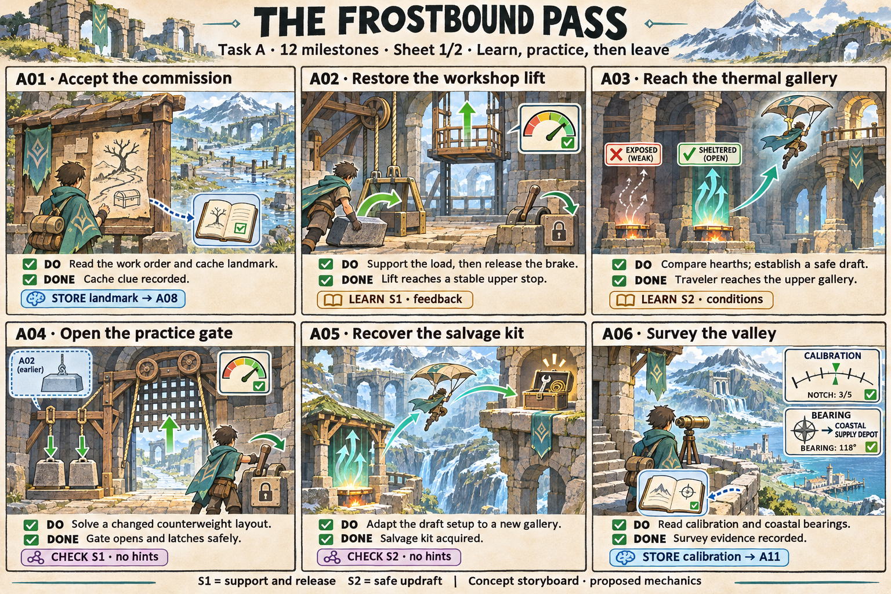
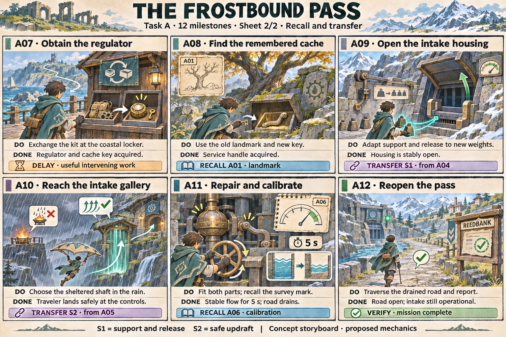
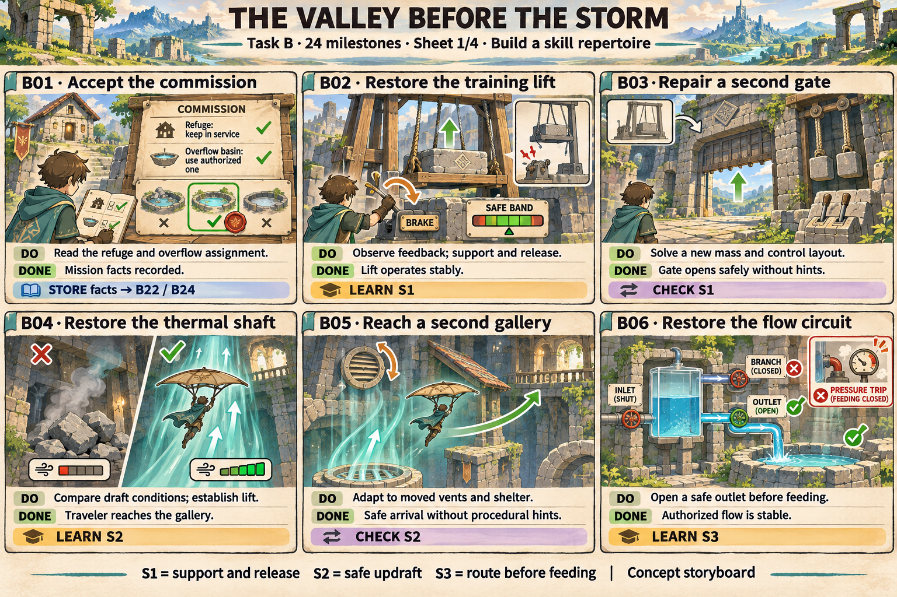
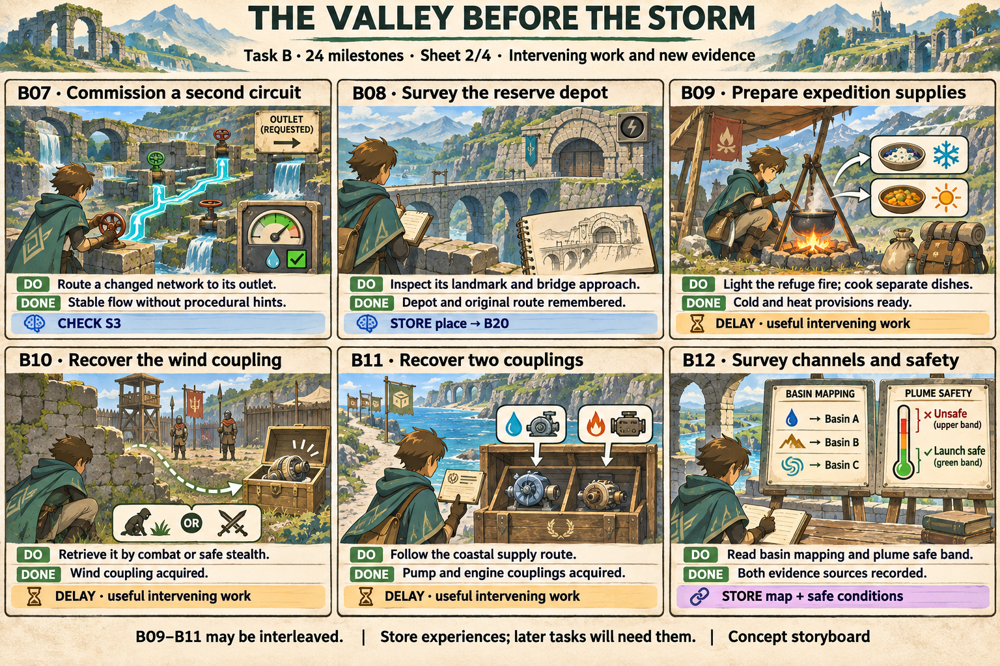
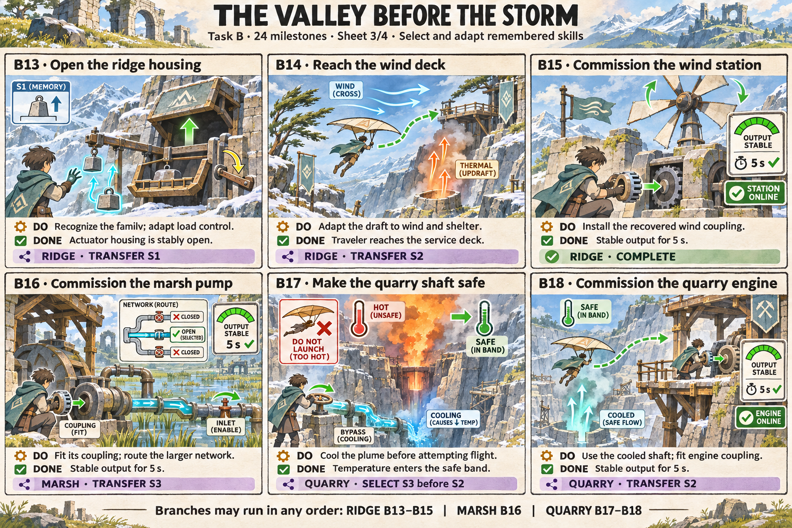
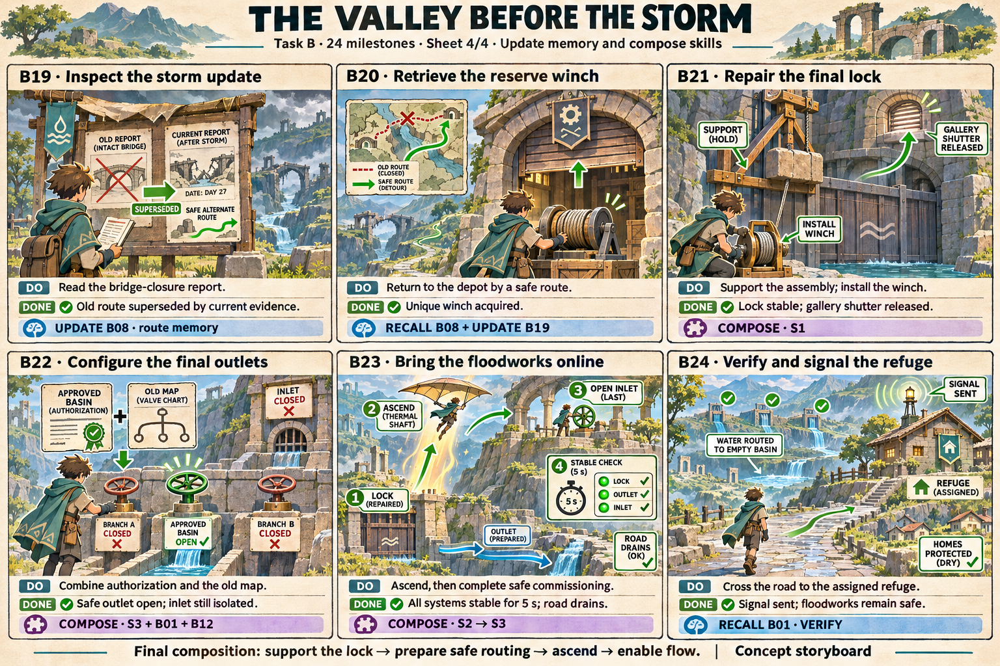

# Wildlands milestone storyboards

Six illustrated sheets cover all **12 milestones of The Frostbound Pass** and
all **24 milestones of The Valley Before the Storm**. Read each sheet from
left to right, then top to bottom. Each panel shows the action, a completion
condition, and the memory or reusable skill involved.

[Download all six full-resolution sheets and their prompts](../assets/design/wildlands-milestones.zip).

These are concept illustrations of proposed tasks, not screenshots of an
implemented environment. They are design/evaluator material: the memory labels
and suggested solutions should not appear in the agent's task observations.
The [task specification](wildlands-long-horizon-tasks.md) defines the full
completion predicates, dependencies, alternate solutions, and scoring.

| Label | Meaning |
| --- | --- |
| S1 | Support and release: hold a mechanism, establish a safe supported load, then release and verify. |
| S2 | Safe updraft: establish a usable draft, check conditions, and ascend to a reachable landing. |
| S3 | Route before feeding: isolate inflow, configure a safe outlet, then enable and verify flow. |
| Learn / Check | Acquire experience, then demonstrate immediate competence without procedural hints. |
| Store / Recall | Save episode-specific information and use it later. |
| Transfer / Compose | Adapt an earlier skill or combine several skills in a new setting. |
| Update | Replace a stale fact using newly observed evidence. |

## Task A: The Frostbound Pass

### A01–A06: learn, practice, and leave

Accept the commission, learn two mechanisms, demonstrate both skills on changed
fixtures, then leave the workshop for a survey expedition. A01's cache landmark
and A06's calibration will matter much later.

[Open full-resolution sheet A01–A06](../assets/design/wildlands-milestones/task-a-01-06.png)

### A07–A12: retrieve, transfer, and complete

Obtain parts, find a remembered cache, transfer both skills to the mountain
intake, recall the calibration, and reopen the road. The milestone outcomes
remain valid if an agent finds a physically sound alternate solution; a bypassed
skill probe is separately recorded as not exercised.

[Open full-resolution sheet A07–A12](../assets/design/wildlands-milestones/task-a-07-12.png)

## Task B: The Valley Before the Storm

### B01–B06: acquire the skill repertoire

Record the mission's refuge and overflow authorization, learn counterweight and
thermal procedures, demonstrate each without hints, and begin learning safe
flow routing.

[Open full-resolution sheet B01–B06](../assets/design/wildlands-milestones/task-b-01-06.png)

### B07–B12: intervening work and new evidence

Check flow-routing competence, remember a depot that is not yet accessible,
prepare supplies, recover parts, and record channel mappings and a temperature
warning. B09–B11 can be interleaved; their position on the sheet is a reading
order, not an enforced execution order.

[Open full-resolution sheet B07–B12](../assets/design/wildlands-milestones/task-b-07-12.png)

### B13–B18: select and adapt remembered skills

The **ridge branch B13–B15**, **marsh branch B16**, and **quarry branch B17–B18**
can run in any order after B12. The quarry is the applicability test: a visible
updraft is initially unsafe, so the agent must cool it before applying the
thermal traversal skill.

[Open full-resolution sheet B13–B18](../assets/design/wildlands-milestones/task-b-13-18.png)

### B19–B24: update memory and compose skills

Update the depot route after the storm, retrieve the winch, and combine all three
skills at the final lock. Safe outlet selection also requires joining B01's
authorization with B12's symbol map. Verify the live system before signaling the
designated refuge.

[Open full-resolution sheet B19–B24](../assets/design/wildlands-milestones/task-b-19-24.png)

## Asset provenance

Illustrations generated with the built-in `image_gen` tool. The complete
[prompt set and exact panel captions](../assets/design/wildlands-milestones/prompts.json)
are stored alongside the images. Example weight arrangements, crests, landmarks,
and colors illustrate the design; they do not fix the randomized benchmark seeds.
